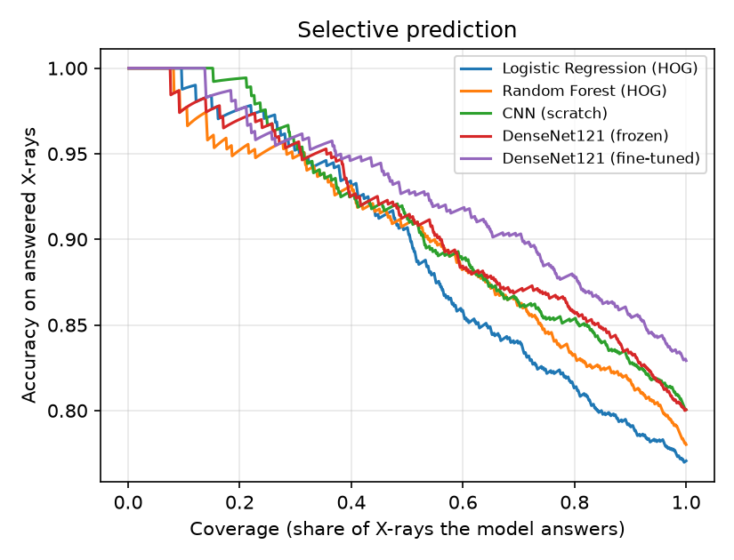
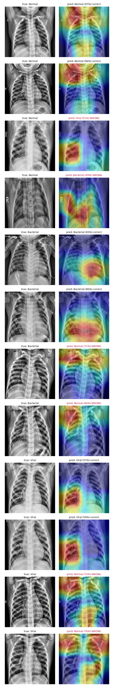

# Multi-Class Pneumonia Detection from Chest X-Rays, with Explainable and Trustworthy AI

A 3-class chest X-ray classifier (**Normal / Bacterial Pneumonia / Viral Pneumonia**). It compares
classical ML, a custom CNN and DenseNet121 transfer learning on a **patient-level split**,
and adds **Grad-CAM explanations**, **calibrated confidence**, a **"refer to radiologist"
abstention mode** and a **shortcut-learning audit**. All of it ships in a Streamlit app.

> ⚠️ Educational project. Not a medical device and not for clinical use.

## What makes this different from the usual pneumonia tutorial

| Typical tutorial | This project |
|---|---|
| Binary: Normal vs Pneumonia | **3-class**: bacterial vs viral is the genuinely hard part |
| Random image split, where the same patient appears in train and test | **Patient-grouped, stratified split** (patient ID parsed from filenames, leakage asserted = 0) |
| Accuracy only | Macro-F1, OvR ROC-AUC, **bootstrap 95% CIs**, **McNemar significance tests** |
| Raw softmax as "confidence" | **Temperature-scaled** probabilities with before/after reliability diagrams (ECE) |
| Always answers | **Selective prediction**: abstains below a validation-tuned threshold, with a risk-coverage curve |
| Grad-CAM pictures | Grad-CAM **plus a border-attention audit** that checks whether the model looks at lungs or at hospital markers |
| — | **Binary vs subtype breakdown** that shows where the difficulty actually is |

## Results

Test set: 837 X-rays from patients never seen in training. Brackets are 95% bootstrap CIs, and
*p* is a McNemar test against the fine-tuned DenseNet. Full report: [reports/model_comparison.md](reports/model_comparison.md).

| Model | Accuracy | Macro-F1 | ROC-AUC (OvR) | p vs best |
|---|---|---|---|---|
| Logistic Regression (HOG) | 0.771 [0.744–0.798] | 0.762 [0.734–0.790] | 0.900 | 1.2e-05 |
| Random Forest (HOG) | 0.780 [0.751–0.808] | 0.747 [0.717–0.779] | 0.905 | 5.7e-06 |
| CNN (scratch) | 0.800 [0.775–0.826] | 0.787 [0.761–0.813] | 0.904 | 0.0097 |
| DenseNet121 (frozen) | 0.800 [0.774–0.827] | 0.779 [0.752–0.807] | 0.908 | 0.0088 |
| **DenseNet121 (fine-tuned)** | **0.829 [0.805–0.853]** | **0.811 [0.785–0.838]** | **0.924** | — |

The fine-tuned DenseNet is significantly better than every other model (p < 0.01).

### Where the difficulty actually is

| Model | Normal vs Pneumonia acc / AUC | Bacterial vs Viral acc / macro-F1 |
|---|---|---|
| Logistic Regression (HOG) | 0.938 / 0.983 | 0.748 / 0.728 |
| CNN (scratch) | 0.951 / 0.985 | 0.782 / 0.752 |
| **DenseNet121 (fine-tuned)** | **0.959 / 0.993** | **0.809 / 0.781** |

Detecting pneumonia at all is close to solved: even HOG + logistic regression reaches 94%.
All the remaining error sits in separating bacterial from viral. The viral class F1 is 0.65
even for the best model, which matches the fact that radiologists also find this distinction
hard from a single X-ray. The "99% accuracy" numbers seen online are for the binary task,
usually on a split with patient leakage.

### Knowing when not to answer

The confidence threshold is tuned on validation so that answered cases reach 90% accuracy, and it is
**0.76**. On test, the model then answers **60.9%** of X-rays at **91.8%** accuracy (vs 82.9% if it must
answer everything). The remaining 39% are flagged "refer to radiologist".



### Calibration: an honest negative result

Temperature scaling fitted T = 1.08, so the fine-tuned model was already well calibrated (ECE 0.040).
Scaling did not improve test ECE (0.053), and the report says so rather than hiding it.

### Grad-CAM and the shortcut audit



- On correct bacterial cases the heatmaps sit on lung opacities, i.e. the model looks at the right anatomy.
- In one misclassified *Normal* X-ray (predicted Bacterial at 49%), the heatmap sits on the **"R" laterality marker**, a textbook shortcut.
- Across all 837 test images, 32% of Grad-CAM mass falls in the 12% border strip, against 42% for a uniform map. The model focuses centrally, but not strongly. Misclassified images show about the same border attention as correct ones (0.33 vs 0.32), so shortcuts don't explain most errors.

### What I tried

| Version | Change | Test acc / macro-F1 |
|---|---|---|
| DenseNet v1 | stage 1 patience 4; stage 2 unfreeze last 60 layers at lr 1e-5 | 0.797 / 0.781 |
| **DenseNet v2** | stage 1 patience 6; stage 2 unfreeze from `conv4_block13` (144 non-BN layers) at lr 1e-4 | **0.829 / 0.811** |

v1 was **underfitting**: train accuracy (71%) stayed *below* validation (77%). The usual "tiny LR for
fine-tuning" advice was too conservative for the large domain gap between ImageNet and X-rays. Logs are in `reports/logs/`.

## Pipeline

```
Kaggle (5,856 images) → filename relabel (3 classes) + patient ID → patient-grouped 70/15/15 split
   │
   ├─ grayscale → CLAHE → 128px → HOG → LogReg / Random Forest
   └─ grayscale → CLAHE → 224px → aug (rot/zoom/shift/brightness, no flip)
          ├─ CNN from scratch
          └─ DenseNet121: stage 1 frozen (lr 1e-3) → stage 2 from conv4_block13, BN frozen (lr 1e-4)
   │
   ├─ evaluation: metrics + bootstrap CIs + McNemar → model_comparison.md
   ├─ temperature scaling (fit on val) → abstention threshold (fit on val)
   ├─ Grad-CAM + border-attention audit
   └─ Streamlit app: prediction, calibrated confidence, abstain warning, heatmap, focus check
```

## Run it

Trained on a MacBook (Apple M5, 16 GB, TF 2.18 + Metal GPU). A full run takes about 1.5 hours:
~20 min for the CNN and ~60 min for DenseNet. Also works on Linux, Windows and Colab.

```bash
python3.12 -m venv .venv && source .venv/bin/activate
pip install -r requirements.txt

python -m src.data.make_manifest --download      # ~2.3 GB, no Kaggle API key needed
python -m src.data.eda                           # EDA figures + demo samples for the app
python -m src.models.baseline_ml                 # HOG + LogReg / RF
python -m src.models.train_dl --model cnn
python -m src.models.train_dl --model densenet   # stage 1 + stage 2
python -m src.evaluation.compare                 # comparison table, calibration, abstention
python -m src.evaluation.gradcam_report          # Grad-CAM grid + shortcut audit

streamlit run app/streamlit_app.py
pytest -q                                        # unit tests (split leakage, calibration, metrics)
```

Or run everything with `./run_all.sh`. Add `--quick` to any `train_dl` command for a 1-epoch smoke test.

## Project layout

```
src/
  utils/config.py            paths, class order, image sizes, seeds
  data/make_manifest.py      relabel + patient IDs + grouped stratified split
  data/preprocess.py         shared preprocessing (train == inference)
  data/dataset.py            tf.data pipeline, augmentation, class weights
  data/features.py           HOG features
  data/eda.py                EDA figures
  models/baseline_ml.py      LogReg / RF
  models/cnn_scratch.py      custom CNN
  models/densenet_transfer.py DenseNet121 + freeze/unfreeze helpers
  models/train_dl.py         training entry point
  models/gradcam.py          Grad-CAM, overlay, border attention
  models/calibration.py      temperature scaling
  evaluation/metrics.py      metrics, CIs, ECE, plots
  evaluation/selective.py    risk-coverage, abstention threshold
  evaluation/compare.py      builds reports/model_comparison.md
  evaluation/gradcam_report.py
app/  streamlit_app.py, inference.py
tests/
```

## Design decisions

- **Patient-level split.** Many patients have several X-rays (up to 31). A random split leaks near-duplicates into test and inflates scores. The dataset reuses `personN` numbers across the bacterial/viral and train/test folders for different children, so we group on the bare number. That merges some unrelated children, but no single child can ever be split across sets. The result is 5,856 images, 3,118 groups, 4,182 / 837 / 837 split.
- **CLAHE.** It evens out contrast across very different X-ray machines. It runs in exactly one function, which training and the app both call.
- **No horizontal flip.** Anatomy is not symmetric (the heart sits on the left).
- **BatchNorm frozen during fine-tuning.** Small batches would otherwise overwrite the ImageNet statistics.
- **`class_weight` instead of oversampling.** Duplicated images would make the model overfit to them.
- **Temperature scaling.** One parameter, and it cannot change predictions. It is fitted every run and reported honestly even when it does not help.
- **Grad-CAM on `relu`**, the final DenseNet activation. The model is built so this layer is directly reachable.

## Limitations

- Single-centre, paediatric (age 1–5) data from Guangzhou. There is no external validation.
- Bacterial vs viral labels come from the original dataset, and even radiologists find this distinction hard.
- The border-attention audit is a heuristic, not a lung segmentation.

## Future work

- External test set (e.g. RSNA or ChestX-ray14 subsets) to measure domain shift.
- Lung-segmentation mask so the audit uses real lung regions.
- Hierarchical classifier (Normal vs Pneumonia → Bacterial vs Viral).
- EfficientNetV2 / ConvNeXt backbones and a small ensemble for better uncertainty.

## Data

Kermany, Zhang, Goldbaum (2018), *Labeled Optical Coherence Tomography (OCT) and Chest X-Ray Images for Classification*, Mendeley Data, CC BY 4.0. Kaggle mirror: `paultimothymooney/chest-xray-pneumonia`. Images are not committed to this repo.
