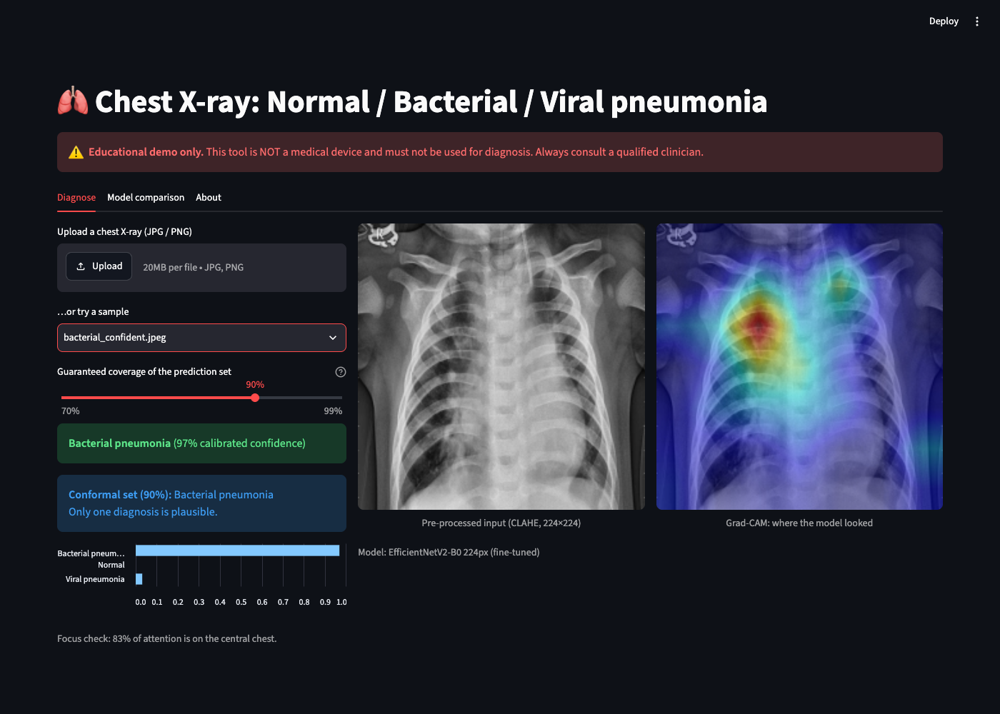
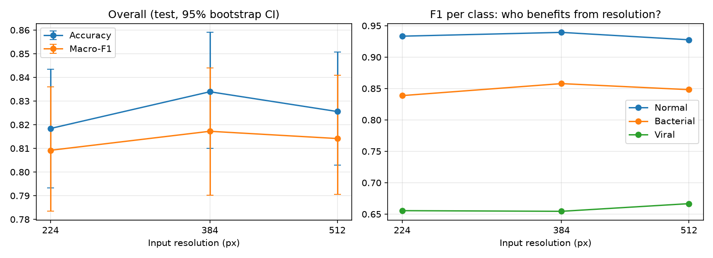
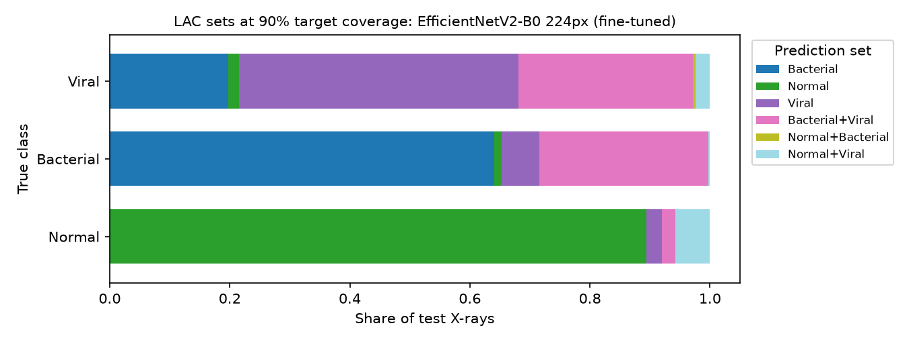
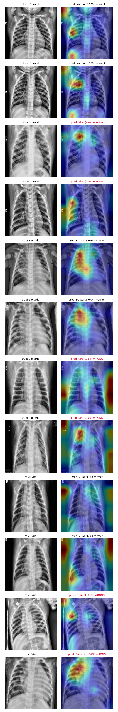

# PneumoScope-XAI: 3-class pneumonia detection from chest X-rays, with explainable and trustworthy AI

A chest X-ray classifier for **Normal / Bacterial pneumonia / Viral pneumonia**. It benchmarks
classical ML, a custom CNN, DenseNet121 and **EfficientNetV2 at three input resolutions** on a
**patient-level split**. Every prediction comes with **calibrated confidence**, a **"refer to
radiologist"** abstention mode, a **conformal prediction set with a coverage guarantee**, and a
**Grad-CAM heatmap with a shortcut audit**. All of it runs in a Streamlit app.

> ⚠️ Educational project. Not a medical device and not for clinical use.

📄 **Full technical report:** [docs/PROJECT_REPORT.md](docs/PROJECT_REPORT.md) (architecture, maths, every file explained, all experiments)



## What makes this different from the usual pneumonia tutorial

| Typical tutorial | This project |
|---|---|
| Binary: Normal vs Pneumonia | **3-class**: bacterial vs viral is the genuinely hard part |
| Random image split (same patient in train and test) | **Patient-grouped, stratified split**, leakage asserted = 0 |
| One model, accuracy only | **11 models**, macro-F1, ROC-AUC, **bootstrap 95% CIs**, **McNemar tests** |
| "Bigger input = better" assumed | **Resolution study**: EfficientNetV2 at 224 / 384 / 512 px, accuracy *and* compute cost |
| Softmax as "confidence" | **Temperature scaling** + **conformal prediction sets** (LAC, APS, randomized APS, class-conditional) with a guaranteed coverage level |
| Always answers | **Selective prediction**: abstains below a validation-tuned threshold |
| Grad-CAM pictures | Grad-CAM **plus a border-attention audit** for shortcut learning |
| Trust the GPU | Found and fixed a **silent tensorflow-metal bug** that changed model outputs; all models retrained |

## Results

Test set: 837 X-rays from patients never seen in training. 95% bootstrap CIs in brackets.
The deployed model is chosen by **validation** macro-F1, so the test set played no part in the choice.

| Model | Test accuracy | Test macro-F1 | ROC-AUC |
|---|---|---|---|
| Logistic Regression (HOG) | 0.771 [0.744–0.798] | 0.762 | 0.900 |
| Random Forest (HOG) | 0.780 [0.751–0.808] | 0.747 | 0.905 |
| CNN (scratch) | 0.812 [0.789–0.838] | 0.800 | 0.914 |
| DenseNet121 (fine-tuned) | 0.829 [0.804–0.853] | 0.816 | 0.930 |
| **EfficientNetV2-B0 224px (fine-tuned)** ⭐ deployed | 0.818 [0.793–0.843] | 0.809 | 0.916 |
| EfficientNetV2-B0 384px (fine-tuned) | 0.834 [0.810–0.859] | 0.817 | 0.924 |
| EfficientNetV2-B0 512px (fine-tuned) | 0.826 [0.803–0.851] | 0.814 | 0.928 |

Deep models clearly beat HOG baselines (McNemar p < 0.01). The fine-tuned deep models are **statistically
tied** (p ≥ 0.13): with ~4k training images, the data, not the architecture, is the bottleneck.
All 11 models (including the frozen-backbone stages): [reports/model_comparison.md](reports/model_comparison.md).

### Where the difficulty is

Normal vs Pneumonia: **96.3% accuracy, AUC 0.993** (deployed model). Bacterial vs Viral: **79.4%**.
80% of all errors are bacterial↔viral confusions, and Viral F1 is ~0.65 for every model.

### Resolution study (A): does EfficientNetV2 see more at higher resolution?

| Resolution | Test acc | Viral F1 | Bacterial vs Viral acc | GFLOPs / image | ms / image (batch 32) | Train time |
|---|---|---|---|---|---|---|
| 224 px | 0.818 | 0.656 | 0.794 | 1.46 | 5.9 | 37 min |
| 384 px | 0.834 | 0.654 | 0.812 | 4.27 | 11.1 | 46 min |
| 512 px | 0.826 | 0.667 | 0.810 | 7.59 | 20.2 | 61 min |

**Hypothesis not supported.** Viral F1 stays flat, and the best gain (384 px, +1.6 points accuracy) is not
significant (p = 0.13) while costing 2.9× the compute. Details: [reports/resolution_study.md](reports/resolution_study.md).



### Conformal prediction (C): answers with a guarantee

Calibrated on 837 validation X-rays at a **90%** target. The app lets the user pick 70–99%.

| | LAC (used in the app) | Class-conditional LAC |
|---|---|---|
| Coverage (mean over 500 random calibration splits) | 90.1% | 90.1% (≈ 90.2% **per class**) |
| Average set size | 1.24 labels | 1.33 |
| Single-label answers | 76% (87.1% correct) | 67% |
| Viral coverage (val → test) | 77.9% | 86.4% |

Typical sets: {Bacterial} 36%, {Normal} 25%, **{Bacterial, Viral} 21%**, {Viral} 16%. When the model
can't tell the subtype, it says so. Details: [reports/conformal_report.md](reports/conformal_report.md).



### Trust layers on the deployed model

* **Abstention:** answers 73% of X-rays at 88.1% accuracy; refers the rest.
* **Calibration:** T = 0.98, so the model is already close to calibrated (ECE 0.050 → 0.048).
* **Grad-CAM audit:** bacterial predictions focus on lung consolidation (border attention 0.247). **Viral predictions partly rely on image borders** (0.357, same pattern in DenseNet). That suggests a non-anatomical cue in the data and is the project's main open limitation.



### The GPU bug that changed the numbers

The app showed 79% confidence on an X-ray the evaluation had scored at 97%. The pixels were identical.
The cause: **tensorflow-metal's graph optimizer computes different outputs than CPU/eager** for the
same weights (0.969 vs 0.801 on one image; up to 11% of test predictions changed class).
Fix: disable Grappler's meta-optimizer on Apple Silicon ([src/utils/runtime.py](src/utils/runtime.py)),
then retrain every deep model. Pre-fix evidence is in [reports/metal_bug/](reports/metal_bug/).
Story and data: report Section 13.4.

## Pipeline

```
Kaggle (5,856 images) → relabel 3 classes + patient ID → patient-grouped 70/15/15 split
   │
   ├─ gray → CLAHE → 128px → HOG → LogReg / Random Forest
   └─ gray → CLAHE → 224 | 384 | 512 px → augment (rot/zoom/shift/brightness/contrast, no flip)
          ├─ CNN from scratch
          ├─ DenseNet121       : stage 1 frozen (1e-3) → stage 2 from conv4_block13, BN frozen (1e-4)
          └─ EfficientNetV2-B0 : stage 1 frozen (1e-3) → stage 2 from block5a,       BN frozen (1e-4)
   │
   ├─ compare.py          metrics + CIs + McNemar, deploy model chosen on VAL, temperature, abstention
   ├─ resolution_study.py accuracy vs resolution vs compute
   ├─ conformal.py        LAC / APS / randomized APS / class-conditional, calibrated on VAL
   ├─ gradcam_report.py   heatmaps + border-attention audit
   └─ Streamlit app       prediction, calibrated confidence, abstain, conformal set (slider), heatmap
```

## Run it

Trained on a MacBook Air (Apple M5, 16 GB, TF 2.18 + Metal GPU). The full pipeline takes ≈ 3.5–4 h.

```bash
python3.12 -m venv .venv && source .venv/bin/activate
pip install -r requirements.txt

python -m src.data.make_manifest --download                    # ~2.3 GB, no Kaggle API key needed
python -m src.data.eda                                         # EDA figures
python -m src.models.baseline_ml                               # HOG + LogReg / RF
python -m src.models.train_dl --model cnn
python -m src.models.train_dl --model densenet
for r in 224 384 512; do python -m src.models.train_dl --model effnetv2 --img-size $r; done
python -m src.evaluation.compare                               # picks + records the deployed model
python -m src.evaluation.resolution_study
python -m src.evaluation.conformal
python -m src.evaluation.gradcam_report

streamlit run app/streamlit_app.py
pytest -q                                                      # 13 unit tests
```

Or `./run_all.sh` (add `--quick` for a 1-epoch smoke test of every stage).

## Project layout

```
src/
  utils/config.py              paths, class order, sizes, seeds, study + conformal settings
  utils/runtime.py             tensorflow-metal graph-optimizer fix
  data/make_manifest.py        relabel + patient IDs + grouped stratified split
  data/preprocess.py           shared preprocessing (train == inference)
  data/dataset.py              tf.data pipeline (any resolution), augmentation, class weights
  data/features.py, eda.py     HOG features, EDA figures
  models/registry.py           one spec per model: file, input size, Grad-CAM layer
  models/baseline_ml.py        LogReg / RF
  models/cnn_scratch.py        custom CNN
  models/densenet_transfer.py  DenseNet121 + freeze/unfreeze helpers
  models/efficientnet_transfer.py  EfficientNetV2 at any resolution
  models/train_dl.py           training entry point (+ cost logging)
  models/gradcam.py            Grad-CAM, overlay, border attention
  models/calibration.py        temperature scaling
  evaluation/metrics.py        metrics, CIs, ECE, plots
  evaluation/selective.py      risk-coverage, abstention threshold
  evaluation/compare.py        model comparison + deployed-model selection
  evaluation/resolution_study.py
  evaluation/conformal.py      split conformal prediction
  evaluation/cost.py           FLOPs, latency, memory, epoch time
  evaluation/gradcam_report.py
  evaluation/reference_inference.py  Metal-vs-reference diagnostic
app/  streamlit_app.py, inference.py
docs/ PROJECT_REPORT.md, images/
tests/
```

## Limitations

- Single-centre, paediatric (age 1–5) data; no external validation.
- Bacterial vs viral labels come from clinical records and are hard to tell apart even for radiologists.
- The validation split is reused for early stopping, model selection and calibration; the report measures the resulting optimism (≈ 2–4 points of coverage on the Viral class).
- Viral predictions partly rely on non-anatomical image regions (border attention audit).
- One training run per configuration; differences under ~1–2 points are within noise.

## Data

Kermany, Zhang, Goldbaum (2018), *Labeled Optical Coherence Tomography (OCT) and Chest X-Ray Images for Classification*, Mendeley Data, CC BY 4.0. Kaggle mirror: `paultimothymooney/chest-xray-pneumonia`. Images are not committed to this repo, apart from four demo X-rays in `app/assets/samples/`.
