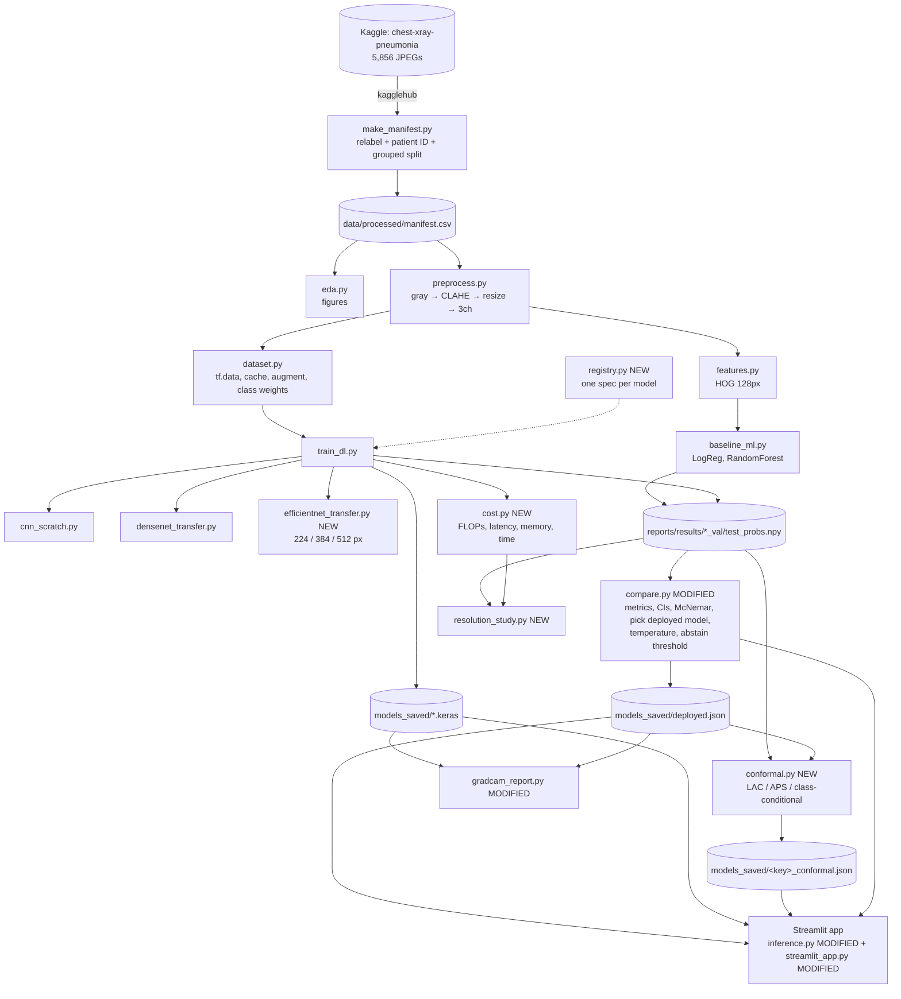
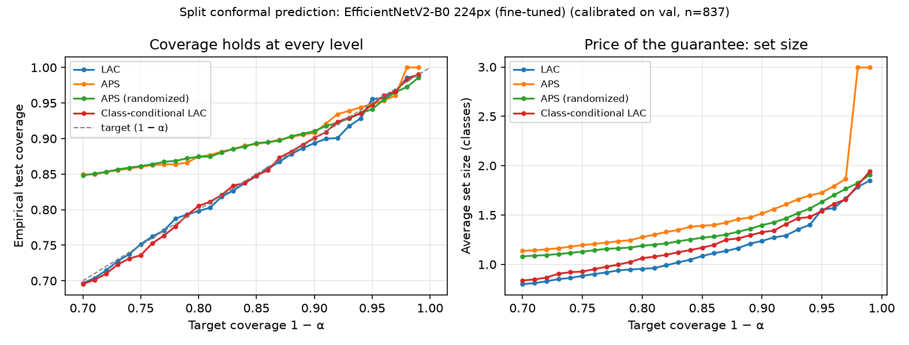
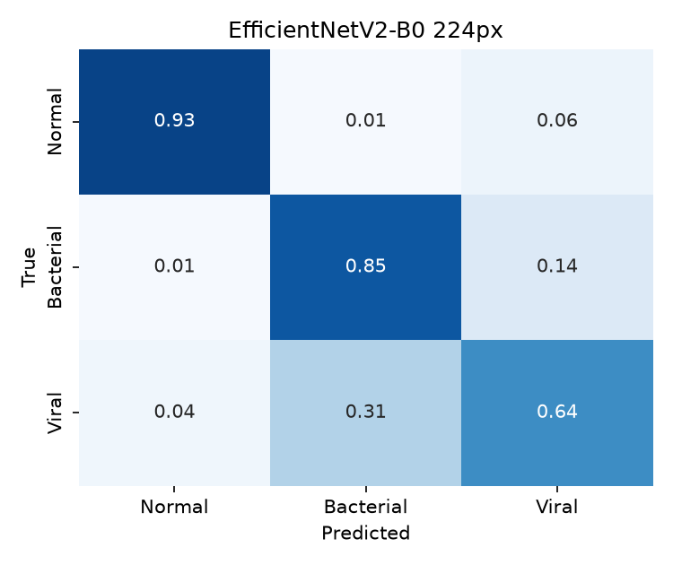
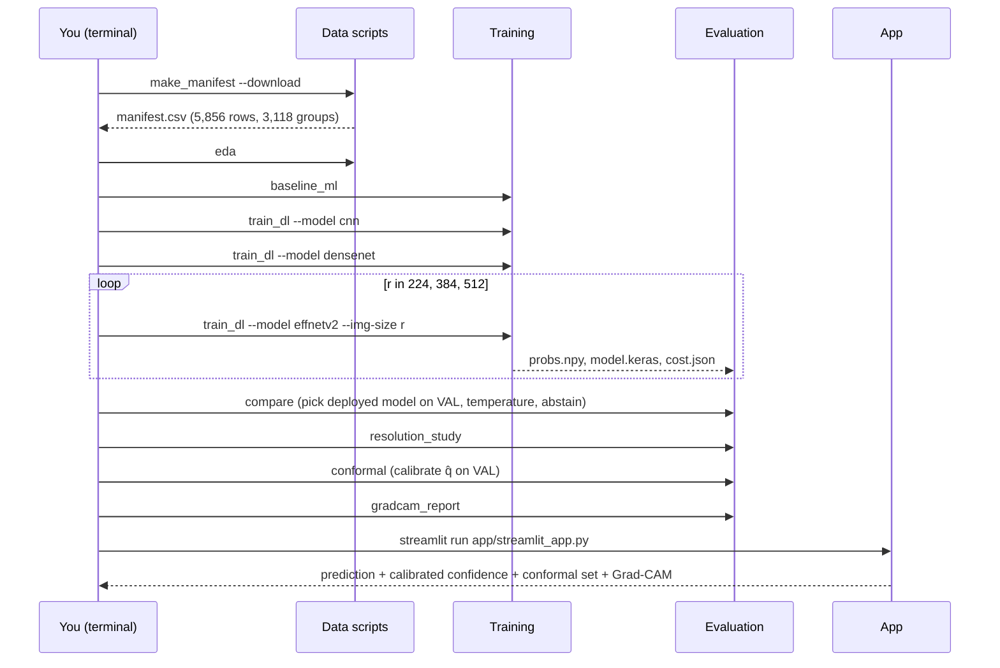

# PneumoScope-XAI: Technical Report

**3-class pneumonia classification from chest X-rays (Normal / Bacterial / Viral), with explainability, calibrated confidence, conformal prediction sets and an EfficientNetV2 resolution study**

| | |
|---|---|
| Repository | https://github.com/sumankit/PneumoScope-XAI |
| Author | Ankit Singh |
| Hardware used for every number in this report | Apple MacBook Air, Apple M5, 16 GB unified memory, TensorFlow 2.18.1 + tensorflow-metal 1.2.0 (GPU) |
| Report date | 2026-10-15 |

> **Medical disclaimer.** This is an educational / portfolio project. It is not a medical device and must not be used for diagnosis.

---

## How to read this report

* Every number in the results sections was produced by the code in this repository on the hardware above, and comes from a file under `reports/` that you can open. Nothing is estimated or copied from papers. Where something was **not** measured or **not** implemented, the report says so.
* Code is marked by its status relative to the version before this round of work:
  * **[EXISTING]**: code that already existed and was not changed.
  * **[MODIFIED]**: existing code that was changed in this round; the change is described.
  * **[NEW]**: code added in this round (EfficientNetV2, resolution study, conformal prediction, model registry, cost measurement).
* File references are clickable relative paths, e.g. [src/evaluation/conformal.py](../src/evaluation/conformal.py).

## Table of contents

1. [Project overview](#1-project-overview)
2. [System architecture](#2-system-architecture)
3. [Technology stack](#3-technology-stack)
4. [Dataset and preprocessing](#4-dataset-and-preprocessing)
5. [Model architectures (with EfficientNetV2 in depth)](#5-model-architectures)
6. [Resolution study (A)](#6-resolution-study-a)
7. [Conformal prediction (C)](#7-conformal-prediction-c)
8. [Training pipeline](#8-training-pipeline)
9. [Evaluation and results](#9-evaluation-and-results)
10. [Complete code explanation](#10-complete-code-explanation)
11. [End-to-end execution](#11-end-to-end-execution)
12. [Application (frontend/backend) integration](#12-application-frontendbackend-integration)
13. [Experiments, findings, errors and fixes](#13-experiments-findings-errors-and-fixes)
14. [Reproducibility](#14-reproducibility)
15. [Conclusion and future scope](#15-conclusion-and-future-scope)
16. [Appendix: glossary](#16-appendix-glossary)

---

## 1. Project overview

### 1.1 Problem statement

Given a paediatric chest X-ray, classify it into one of three classes:

| Class | Meaning |
|---|---|
| `NORMAL` | No pneumonia |
| `PNEUMONIA_BACTERIA` | Bacterial pneumonia: typically a dense, localised *lobar consolidation* (one region turns white) |
| `PNEUMONIA_VIRUS` | Viral pneumonia: typically a diffuse, *interstitial* pattern of fine streaks spread over both lungs |

The public dataset ships with only two folders (`NORMAL`, `PNEUMONIA`). The bacterial/viral split is recovered from filenames, which turns a well-known, nearly solved binary task into a much harder 3-class one.

### 1.2 Motivation

* **Binary pneumonia detection is a tutorial problem.** On this dataset even HOG features + logistic regression reach ~94% binary accuracy (Section 9). It shows little.
* **Bacterial vs viral matters clinically.** Bacterial pneumonia is treated with antibiotics; viral is not. Telling them apart from one X-ray is hard even for radiologists.
* **Medical AI needs more than accuracy.** A useful assistant must (a) not cheat through data leakage, (b) show *why* it decided, (c) give confidence values that mean something, and (d) know when to stay quiet.

### 1.3 Objectives

1. Build a leakage-free 3-class dataset (patient-level split).
2. Benchmark a ladder of models on the same split and metrics: classical ML (HOG + Logistic Regression / Random Forest) → CNN from scratch → DenseNet121 transfer learning → **EfficientNetV2 transfer learning [NEW]**.
3. **Resolution study (A) [NEW]:** test whether higher input resolution helps, especially for the subtle viral class, and what it costs in compute.
4. Make predictions trustworthy:
   * Grad-CAM explanations plus a "shortcut" audit;
   * temperature-scaling calibration;
   * selective prediction ("refer to radiologist");
   * **conformal prediction sets with a statistical coverage guarantee (C) [NEW]**.
5. Ship everything in a Streamlit app.

### 1.4 Expected vs actual outcomes

Expected outcomes, as framed before the work, were: deep models beat classical ML; the binary task is easy and the subtype task is hard; higher resolution helps viral detection; conformal sets give guaranteed coverage and are small for confident cases. Section 9 and Section 13 report what actually happened, including the hypotheses that did **not** hold.

---

## 2. System architecture

### 2.1 Component diagram



### 2.2 Design principles

| Principle | How it shows up in code |
|---|---|
| **One source of truth for preprocessing** | Training (`dataset.py`), evaluation and the app all call functions in `preprocess.py`. Model-specific normalisation lives *inside* each Keras model as layers. |
| **One source of truth for models** [NEW] | `registry.py` lists every model's key, file, input size and Grad-CAM layer; every consumer looks models up there. |
| **Decouple training from analysis** | Training scripts save val/test probabilities as `.npy`. All metrics, calibration, conformal and comparisons are computed from those files, so analyses can be re-run in seconds without retraining. |
| **Test set touched once** | Everything that is *tuned* (early stopping, temperature, abstain threshold, conformal q̂, choice of deployed model) uses the validation split only. |
| **Configuration in one place** | `src/utils/config.py` holds every path, size, seed and hyperparameter that more than one file needs. |

### 2.3 Data flow of artifacts

| Stage | Reads | Writes |
|---|---|---|
| `make_manifest` | raw images | `data/processed/manifest.csv` |
| `eda` | manifest, images | `reports/figures/eda_*.png` |
| `baseline_ml` | manifest, images | `models_saved/{logreg,random_forest}.pkl`, `data/processed/hog_*.npz`, `reports/results/<key>_{val,test}_probs.npy`, `<key>_metrics.json` |
| `train_dl` | manifest, images | `models_saved/<key>.keras`, `reports/results/<key>_{val,test}_probs.npy`, `<key>_history.csv`, `<key>_metrics.json`, `<key>_cost.json` (EfficientNetV2), figures |
| `compare` | all `*_probs.npy` | `reports/model_comparison.md`, `reports/results/summary.json`, `models_saved/deployed.json`, `<key>_temperature.json`, `<key>_abstain.json`, `app/assets/samples/*` |
| `resolution_study` | EfficientNetV2 probs + cost files | `reports/resolution_study.md`, `reports/results/resolution_study.json`, `reports/figures/resolution_*.png` |
| `conformal` | probs of every model, `deployed.json` | `reports/conformal_report.md`, `reports/results/conformal_summary.json`, `models_saved/<key>_conformal.json`, `reports/figures/conformal_*.png` |
| `gradcam_report` | deployed model, test images | `reports/gradcam_analysis_<key>.md`, `reports/figures/gradcam_grid_<key>.png` |
| app | `deployed.json`, model, temperature, abstain, conformal, summaries | UI |

---

## 3. Technology stack

| Technology | Version | Used for | Why this one |
|---|---|---|---|
| Python | 3.12 | Everything | Most recent version supported by TensorFlow 2.18 |
| TensorFlow / Keras 3 | 2.18.1 / 3.15.1 | CNN, DenseNet121, EfficientNetV2, `tf.data`, Grad-CAM gradients | Pretrained `keras.applications`, Apple GPU support via Metal |
| tensorflow-metal | 1.2.0 | Runs TensorFlow on the Apple M5 GPU | TF ≥ 2.19 breaks this plugin, hence the pin to 2.18 |
| NumPy | 2.0.2 | Arrays, conformal maths | Pinned `<2.1` for TF 2.18 compatibility |
| pandas | 3.0.6 | Manifest, tables | |
| scikit-learn | 1.9.1 | Logistic Regression, Random Forest, PCA, `StratifiedGroupKFold`, metrics | Standard ML toolkit |
| scikit-image | 0.26.0 | HOG features | |
| SciPy | 1.18.1 | Temperature fitting (`minimize_scalar`), McNemar exact binomial test | |
| OpenCV (headless) | 5.0.0 | Image I/O, CLAHE, resize, heatmap colouring | Fast, no GUI dependency (server-friendly) |
| Matplotlib / Seaborn | 3.11.2 / 0.13.2 | All report figures | |
| joblib | 1.6.0 | Parallel HOG extraction, saving sklearn models | |
| Pillow | 12.3.0 | Reading uploads in the app | |
| Streamlit | 1.64.0 | Web app | Python-only UI; free hosting on Streamlit Community Cloud |
| kagglehub | 1.0.2 | Dataset download | Public dataset, no API key needed |
| certifi | | CA bundle for HTTPS downloads on macOS | Fixes ImageNet-weight download SSL errors |
| pytest | 9.1.1 | Unit tests | |
| Git / GitHub | | Version control and hosting | |

**Pretrained models used:** DenseNet121 and EfficientNetV2-B0, both with ImageNet weights from `keras.applications`.

---

## 4. Dataset and preprocessing

### 4.1 Source and raw structure

Kermany, Zhang, Goldbaum (2018), *Labeled Optical Coherence Tomography and Chest X-Ray Images for Classification*, Mendeley Data (CC BY 4.0). It contains paediatric patients aged 1–5 from Guangzhou Women and Children's Medical Center. The Kaggle mirror is `paultimothymooney/chest-xray-pneumonia`.

```
chest_xray/
├── train/{NORMAL,PNEUMONIA}/    5,216 images
├── val/{NORMAL,PNEUMONIA}/         16 images   ← far too small to use
├── test/{NORMAL,PNEUMONIA}/       624 images
├── chest_xray/ …                  duplicate copy (ignored)
└── __MACOSX/ …                    macOS junk (ignored)
```

Counts per original folder after relabelling (from `manifest.csv`):

| Original folder | Normal | Bacterial | Viral |
|---|---|---|---|
| train | 1,341 | 2,530 | 1,345 |
| val | 8 | 8 | 0 |
| test | 234 | 242 | 148 |
| **Total** | **1,583** | **2,780** | **1,493** |

### 4.2 Relabelling and patient IDs: [src/data/make_manifest.py](../src/data/make_manifest.py) [EXISTING]

* **Label:** parent folder `NORMAL` → `NORMAL`. Folder `PNEUMONIA` + filename containing `bacteria` → `PNEUMONIA_BACTERIA`, or containing `virus` → `PNEUMONIA_VIRUS`.
* **Patient ID** (regexes):
  * `person1234_bacteria_3131.jpeg` → `PERSON1234`
  * `IM-0115-0001.jpeg` → `IM-0115`, `NORMAL2-IM-1427-0001.jpeg` → `NORMAL2-IM-1427`
* **Finding:** the dataset *reuses* `personN` numbers across the bacterial/viral and train/test namespaces for **different** children. This was verified by visual inspection: `person255_bacteria_*` and `person255_virus_*` are visibly different children. Since we can't tell which reuses are the same child, we group on the bare number. Groups get coarser, but no single child can ever be split across sets. Result: **3,118 groups**; the largest has 31 images.

### 4.3 Patient-grouped stratified split

`grouped_stratified_split()` uses scikit-learn's `StratifiedGroupKFold` twice:

1. `n_splits = round(1 / 0.15) = 7` → one fold (≈1/7) becomes **test**.
2. On the remainder, `n_splits = round(0.85 / 0.15) = 6` → one fold becomes **val**.

*Grouped* means every image of a patient lands in exactly one split. *Stratified* means class proportions are kept per split. A hard check runs afterwards: `assert leaked == 0` (number of patients present in more than one split).

| Split | Normal | Bacterial | Viral | Total | Used for |
|---|---|---|---|---|---|
| train | 1,130 | 1,985 | 1,067 | **4,182** | fitting weights |
| val | 227 | 397 | 213 | **837** | early stopping, LR schedule, temperature, abstain threshold, conformal calibration, choosing the deployed model |
| test | 226 | 398 | 213 | **837** | final, one-time evaluation |

**Why this matters:** with a random image-level split, near-duplicate X-rays of the same child appear in train and test, and the model gets credit for recognising the child. Many published "95%+" results on this dataset have that leak.

### 4.4 Preprocessing: [src/data/preprocess.py](../src/data/preprocess.py) [EXISTING]

The same chain runs at training and at inference:

```
any image ──► to_gray ──► (normalise to uint8) ──► CLAHE ──► resize (INTER_AREA) ──► repeat ×3 channels ──► float32 [0, 255]
```

| Step | Detail | Why |
|---|---|---|
| Grayscale | `cv2.cvtColor` / passthrough | X-rays carry no colour information |
| CLAHE | `clipLimit=2.0, tileGridSize=(8, 8)`, one object **per thread** | Equalises contrast locally; different machines and exposures look more alike, and lung texture stands out |
| Resize | 224×224 for DenseNet/CNN, **224 / 384 / 512 for EfficientNetV2 [MODIFIED: size is now a parameter]**, 128×128 for HOG | Fixed network input |
| 3 channels | the gray channel replicated | ImageNet backbones expect RGB |
| Range | float32 in **[0, 255]** | Every model normalises internally (see 4.6) |

### 4.5 Training-time pipeline: [src/data/dataset.py](../src/data/dataset.py) [MODIFIED]

* `tf.data.Dataset.from_tensor_slices(paths, labels)` → `map(load + CLAHE + resize)` via `tf.numpy_function` → **`.cache()` as uint8 grayscale**. Cached size: ~300 MB at 224px, ~1.5 GB at 512px. The 3-channel float copy is created per batch after the cache, so RAM stays small.
* Train split only: `shuffle(len, reshuffle_each_iteration=True)`, then augmentation.
* `prefetch(AUTOTUNE)` overlaps data loading with GPU work.
* **Change in this round:** `make_dataset(..., img_size=...)` and `_gray_loader(img_size)` replace the hard-coded 224. The default is still 224, so CNN and DenseNet behave exactly as before.

**Augmentation** (Keras preprocessing layers, train only):

| Layer | Setting | Meaning |
|---|---|---|
| `RandomRotation(0.03)` | ±0.03 × 360° ≈ ±10.8° | patient tilt |
| `RandomZoom(0.10)` | ±10% | distance to detector |
| `RandomTranslation(0.05, 0.05)` | ±5% | positioning |
| `RandomBrightness(0.10, value_range=(0, 255))` | ±10% | exposure |
| `RandomContrast(0.10)` | ±10% | exposure |
| *(no flip)* | | the heart is on the left; a mirrored chest is not anatomically valid |

**Class imbalance:** `compute_class_weight("balanced")` on the train split gives weights ≈ {Normal 1.23, Bacterial 0.70, Viral 1.31}, passed to `model.fit(class_weight=...)`. Mistakes on rare classes cost more in the loss, and no images are duplicated.

### 4.6 Normalisation inside the models

| Model | Layers inside the model | Effect |
|---|---|---|
| CNN | `Rescaling(1/255)` | [0, 1] |
| DenseNet121 | `Rescaling(1/255)` → `Normalization(mean=[0.485, 0.456, 0.406], var=std²)` | ImageNet "torch" normalisation |
| EfficientNetV2-B0 [NEW] | `include_preprocessing=True` adds `Rescaling(1/255)` → `Normalization` (ImageNet mean/std) | same convention as the original training |

Since every model accepts raw [0, 255] input, the app never needs model-specific preprocessing code, so it can't get it wrong.

---

## 5. Model architectures

### 5.1 Classical baselines: [src/models/baseline_ml.py](../src/models/baseline_ml.py) [EXISTING]

* **HOG** (`skimage.feature.hog`, 128×128 CLAHE image, `orientations=9, pixels_per_cell=(16,16), cells_per_block=(2,2)`) gives a 1,764-dim vector per image: histograms of edge directions per 16×16 cell, normalised over 2×2 blocks.
* **Logistic Regression:** `StandardScaler → PCA(256) → LogisticRegression(C=0.1, max_iter=2000, class_weight="balanced")`, multinomial softmax.
* **Random Forest:** `RandomForestClassifier(n_estimators=400, class_weight="balanced_subsample", min_samples_leaf=2)`.

These answer the question "how far do hand-crafted features get?", which is the baseline every deep model must beat.

### 5.2 CNN from scratch: [src/models/cnn_scratch.py](../src/models/cnn_scratch.py) [EXISTING]

```
Input 224×224×3 → Rescaling(1/255)
→ 4 × [Conv2D(f, 3×3, same, no bias) → BatchNorm → ReLU → MaxPool 2×2],  f = 32, 64, 128, 256
→ GlobalAveragePooling → Dense(128, ReLU) → Dropout(0.5) → Dense(3, softmax)
```
Grad-CAM layer: `conv4_relu`.

### 5.3 DenseNet121: [src/models/densenet_transfer.py](../src/models/densenet_transfer.py) [EXISTING]

* **Dense connectivity:** inside a dense block, every layer receives the concatenated feature maps of *all* earlier layers. This encourages feature reuse and gives strong gradients with few parameters (~7M). It is the backbone of CheXNet (Rajpurkar et al., 2017).
* Built with `input_tensor=` on top of our normalisation layers, so its layers are part of the outer model and `get_layer("relu")` works for Grad-CAM.
* Head: `GAP → Dense(256, ReLU) → Dropout(0.5) → Dense(3, softmax)`.

### 5.4 EfficientNetV2: [src/models/efficientnet_transfer.py](../src/models/efficientnet_transfer.py) [NEW]

#### 5.4.1 Background

**EfficientNet (V1, Tan & Le 2019)** introduced *compound scaling*: rather than making a network only deeper, wider *or* fed higher-resolution images, scale all three together with fixed ratios. **EfficientNetV2 (Tan & Le, 2021)** improved training speed and parameter efficiency by:

1. **Fused-MBConv blocks in early stages.** A depthwise 3×3 + 1×1 expansion pair is replaced by one regular 3×3 convolution. Depthwise convolutions are slow on accelerators when feature maps are large, so fusing them speeds up the high-resolution early stages.
2. **MBConv blocks with Squeeze-and-Excitation (SE) in later stages.** Inverted bottleneck: 1×1 expand → depthwise 3×3 → SE channel attention → 1×1 project, with a residual connection.
3. **Training-aware NAS and scaling**, plus progressive learning in the original paper. *Progressive learning is **not** used here; every run trains at one fixed resolution.*

#### 5.4.2 The building blocks

**MBConv (inverted residual with SE):**
```
x ─► 1×1 Conv (expand ×e) ─► BN ─► SiLU
  ─► 3×3 Depthwise Conv (stride s) ─► BN ─► SiLU
  ─► SE: GlobalAvgPool ─► FC(reduce) ─► SiLU ─► FC(expand) ─► sigmoid ─► × (per-channel gate)
  ─► 1×1 Conv (project) ─► BN
  ─► (+ x if same shape)   ← residual
```
**Fused-MBConv:**
```
x ─► 3×3 Conv (expand ×e, stride s) ─► BN ─► SiLU ─► 1×1 Conv (project) ─► BN ─► (+ x)
```
* **SiLU / Swish:** `f(x) = x·σ(x)`, a smooth ReLU alternative.
* **Squeeze-and-Excitation** learns to up-weight informative channels per image. In an X-ray that can mean channels that respond to opacity texture.

#### 5.4.3 EfficientNetV2-B0 as instantiated in this project

Extracted from the actual Keras model (input 224×224):

| Stage | Block type | # Blocks | SE | Output (224px input) |
|---|---|---|---|---|
| Stem | 3×3 Conv, stride 2 | – | – | 112×112×32 |
| 1 | Fused-MBConv | 1 | no | 112×112×16 |
| 2 | Fused-MBConv | 2 | no | 56×56×32 |
| 3 | Fused-MBConv | 2 | no | 28×28×48 |
| 4 | MBConv | 3 | yes | 14×14×96 |
| 5 | MBConv | 5 | yes | 14×14×112 |
| 6 | MBConv | 8 | yes | 7×7×192 |
| Top | 1×1 Conv → BN → SiLU (`top_activation`) | – | – | **7×7×1280** |

The network is fully convolutional, so the same weights accept any input size. The final feature map grows with resolution: **7×7 at 224px, 12×12 at 384px, 16×16 at 512px**. That is also the Grad-CAM grid, so higher resolution gives sharper heatmaps.

Our head, identical to DenseNet's so the two backbones are comparable:
```
top_activation (H×W×1280) → GlobalAveragePooling2D → Dense(256, ReLU) → Dropout(0.5) → Dense(3, softmax)
```
Parameters: **6,248,019** in total (backbone 5.9M + head).

#### 5.4.4 Why EfficientNetV2-B0 (and not S)

Measured fine-tuning speed on the M5 (synthetic batches of 16, stage-2 configuration), before choosing. These benchmarks ran *before* the Metal fix (13.4); with the fix, steps are about 15% slower for EfficientNetV2.

| Variant | Params | 224px | 384px | 512px |
|---|---|---|---|---|
| **B0** | 5.9M | 148 ms/step (~0.6 min/epoch) | 276 ms/step (~1.2 min/epoch) | 467 ms/step (~2.0 min/epoch) |
| S | 20.3M | — | 746 ms/step (~3.2 min/epoch) | 1,348 ms/step (~5.9 min/epoch) |

V2-S at 512px would take ~5 hours per run on this laptop. B0 makes a three-resolution study feasible in about 2–3 hours while keeping the comparison fair (same model, same recipe). B0 is also similar in size to DenseNet121 (~7M), so "DenseNet vs EfficientNetV2" is a like-for-like comparison.

#### 5.4.5 Transfer-learning strategy

Same two-stage recipe as DenseNet121, so the backbone is the only difference:

| | Stage 1: feature extraction | Stage 2: fine-tuning |
|---|---|---|
| Trainable | head only (backbone frozen) | stages 5–6 + top (`block5a` onward), **BatchNorm layers stay frozen** |
| Trainable backbone layers | 0 | 154 |
| Optimizer / LR | Adam, 1e-3 | Adam, 1e-4 |
| Max epochs / early-stop patience | 25 / 6 | 25 / 6 |
| Batch size | 16 at every resolution | 16 |

Why BatchNorm stays frozen: in Keras 3 a non-trainable BN layer runs in inference mode, so its ImageNet running statistics are not overwritten by small, domain-shifted batches.

### 5.5 Model registry: [src/models/registry.py](../src/models/registry.py) [NEW]

```python
@dataclass(frozen=True)
class ModelSpec:
    key: str             # prefix of reports/results/<key>_{val,test}_probs.npy
    name: str            # human-readable
    file: str | None     # models_saved/<file>; None for sklearn models
    img_size: int
    gradcam_layer: str | None
    note: str
    deployable: bool     # final (fine-tuned) model that may be served by the app
```

`SPECS` holds 11 entries: logreg, random_forest, cnn_scratch, densenet_frozen, densenet_finetuned, and frozen + fine-tuned EfficientNetV2-B0 at 224, 384 and 512. `effnet_key(res, stage)` gives names like `effnetv2_b0_384_finetuned`. Before this file existed, the model list was hard-coded separately in `compare.py`, `gradcam_report.py` and `inference.py`.

---

## 6. Resolution study (A)

### 6.1 Question and hypothesis

> *Does a higher input resolution help EfficientNetV2 separate bacterial from viral pneumonia?*

**Hypothesis.** Viral pneumonia appears as fine, diffuse interstitial streaks; bacterial pneumonia as large, dense consolidation. Downsampling a ~1,000–2,000 px X-ray to 224 px might wash out the fine viral pattern, so higher resolution should mostly help the **Viral** class and the **Bacterial-vs-Viral** sub-task, while Normal-vs-Pneumonia (large structures) should already be easy at 224 px.

### 6.2 Methodology: one variable at a time

| Held constant | Value |
|---|---|
| Architecture | EfficientNetV2-B0 + identical head |
| Data split | same patient-grouped train/val/test (4,182 / 837 / 837) |
| Preprocessing | grayscale → CLAHE (2.0, 8×8) → resize with `INTER_AREA` → 3 channels |
| Augmentation | identical (rotation, zoom, shift, brightness, contrast) |
| Recipe | stage 1 frozen (Adam 1e-3), stage 2 from `block5a` with BN frozen (Adam 1e-4); early stopping patience 6, ReduceLROnPlateau |
| Batch size | 16 |
| Class weights, seed | balanced; 42 |
| Runtime | TF 2.18 + Metal, **with the graph-optimizer fix** (13.4) |
| **Varied** | **input size: 224, 384, 512 px** |

Because the network is fully convolutional, the same pretrained weights work at any size. Only the spatial size of the feature maps changes (final map 7×7 → 12×12 → 16×16).

**Measured per resolution:** validation macro-F1 (the selection metric); test accuracy, macro-F1 and ROC-AUC with 95% bootstrap CIs; per-class precision/recall/F1; Normal-vs-Pneumonia and Bacterial-vs-Viral accuracy; ECE; McNemar test vs 224 px; GFLOPs per image; inference latency; seconds per epoch; total training time; peak process memory.

### 6.3 Results: accuracy

| Resolution | Val macro-F1 | Test accuracy [95% CI] | Test macro-F1 [95% CI] | ROC-AUC | ECE | McNemar p vs 224 px |
|---|---|---|---|---|---|---|
| 224 px | **0.819** | 0.818 [0.793–0.843] | 0.809 [0.783–0.836] | 0.916 | 0.050 | — |
| 384 px | 0.805 | **0.834** [0.810–0.859] | **0.817** [0.790–0.844] | 0.924 | 0.049 | 0.13 |
| 512 px | 0.809 | 0.826 [0.803–0.851] | 0.814 [0.791–0.841] | **0.928** | **0.036** | 0.53 |

Per class (test; P = precision, R = recall):

| Resolution | Normal P / R / F1 | Bacterial P / R / F1 | Viral P / R / F1 | Normal vs Pneumonia acc | Bacterial vs Viral acc |
|---|---|---|---|---|---|
| 224 px | 0.94 / 0.93 / 0.933 | 0.83 / 0.85 / 0.839 | 0.67 / 0.64 / **0.656** | 0.963 | 0.794 |
| 384 px | 0.92 / 0.96 / 0.939 | 0.82 / 0.89 / 0.858 | 0.74 / 0.59 / **0.654** | 0.969 | 0.812 |
| 512 px | 0.95 / 0.91 / 0.928 | 0.81 / 0.88 / 0.848 | 0.71 / 0.63 / **0.667** | 0.961 | 0.810 |


### 6.4 Results: computational cost

Measured on the Apple M5 (Metal GPU, fix applied):

| Resolution | Params | GFLOPs / image | Inference ms / image, batch 32 | Inference ms / image, batch 1 | Stage-1 s / epoch | Stage-2 s / epoch | Epochs (S1 + S2) | Train time | Peak process memory |
|---|---|---|---|---|---|---|---|---|---|
| 224 px | 6,248,019 | 1.46 | 5.91 | 99.2 | 30 | 101 | 16 + 17 | 37 min | 5.1 GB |
| 384 px | 6,248,019 | 4.27 (×2.9) | 11.10 (×1.9) | 96.8 | 75 | 183 | 8 + 11 | 45 min | 5.8 GB |
| 512 px | 6,248,019 | 7.59 (×5.2) | 20.19 (×3.4) | 93.6 | 109 | 243 | 8 + 11 | 60 min | 7.4 GB |


How to read the cost columns:
* **FLOPs grow ~quadratically with side length:** (384/224)² = 2.9 and (512/224)² = 5.2, which matches the measured ratios exactly.
* **Batch-32 latency** is the meaningful throughput number. **Batch-1 latency (~95 ms) is flat** across resolutions because it is dominated by fixed per-call overhead (Python → TF → Metal dispatch), not by arithmetic. That matters for the app, which processes one image at a time: the resolution barely changes its response time on this hardware.
* **Training time** depends on epochs as well as per-epoch cost. Early stopping ended 384 px and 512 px after fewer epochs (8 + 11) than 224 px (16 + 17), so total time grew only 1.6×, not 2–3×.
* **Peak memory** is the process's peak resident memory over the whole run (cached images + model + optimizer + activations). The rise reflects the bigger image cache and activations.


### 6.5 Interpretation

1. **The hypothesis is not supported.** Viral F1 is flat (0.656 → 0.654 → 0.667). Bacterial-vs-Viral accuracy rises 1.8 points from 224 to 384 px and then plateaus, but neither difference is statistically significant (McNemar p = 0.13 and 0.53; the 95% CIs overlap heavily).
2. **384 px is the best test point**: 83.4% accuracy, 0.858 bacterial F1 and the best bacterial recall (0.89). It costs 2.9× the FLOPs. 512 px adds cost (5.2×) without a further gain.
3. **Validation and test disagree on the ranking.** Validation prefers 224 px (0.819), test prefers 384 px (0.834). With n = 837 per split the CIs are about ±2.5 points, so the three fine-tuned models are statistically indistinguishable. The honest summary is: *at this data scale, resolution beyond 224 px gives at most a small, unproven gain at a large compute cost.*
4. **Likely reasons:** (a) viral vs bacterial is partly a label-noise problem (labels come from clinical work-up, not from the image), which resolution can't fix; (b) at 512 px an ImageNet-pretrained network sees objects at a much larger scale than during pretraining; (c) the frozen stage stopped very early at 384/512 px (best validation epoch = 2), so the head may have been under-trained before fine-tuning began.
5. **Run-to-run variance is about one point.** Before the Metal fix, two runs of the identical 224 px configuration gave 81.0% / 0.806 and 80.8% / 0.800. Differences of ±1 point between configurations should not be read as real without repeats.

**Decision.** The deployed model is chosen by validation macro-F1 (rule fixed in advance), which picked **224 px**. It is also the cheapest. 384 px would be a defensible alternative if test performance were allowed to influence the choice, but it isn't.

### 6.6 Limitations of the study

* One seed per configuration; no confidence interval across training runs.
* Only EfficientNetV2-B0. Larger variants (S/M), which were pretrained at higher resolution, might benefit more.
* No progressive resizing (the EfficientNetV2 paper's training trick) and no resolution-specific tuning of the learning rate or epochs.

## 7. Conformal prediction (C)

### 7.1 The problem it solves

A softmax output such as "Viral 0.62" is not a promise; the model can be confidently wrong. Temperature scaling (Section 10.10) improves calibration *on average*, but it gives no guarantee for the next patient. **Conformal prediction** changes the output: instead of one label, the model returns a **set** of labels and comes with a mathematical guarantee:

$$\Pr\big(\,Y_{\text{test}} \in \mathcal{C}(X_{\text{test}})\,\big) \;\ge\; 1-\alpha$$

For example, with α = 0.10 the true diagnosis is inside the returned set for at least 90% of patients. This holds for **any** model (good or bad, calibrated or not) and needs no distributional assumption beyond *exchangeability* (7.5). A weak model doesn't break the guarantee; it just has to return bigger sets.

In this project that turns into clinically meaningful outputs:

| Set returned | Reading |
|---|---|
| {Normal} | confident: no pneumonia |
| {Bacterial} | confident: bacterial pneumonia |
| {Bacterial, Viral} | "pneumonia, but I can't tell the type at this guarantee level" |
| {Normal, Bacterial, Viral} | "I can't rule anything out" |
| {} (LAC only) | the image looks unlike anything in calibration (possible out-of-distribution input) |

### 7.2 Split conformal procedure

We use **split (inductive) conformal prediction**, which needs no retraining:

1. **Train** a classifier $\hat p(x) \in \Delta^{K}$ on the training split (already done).
2. **Choose a nonconformity score** $s(x, y)$: large when label $y$ looks implausible for image $x$.
3. **Calibrate** on $n$ held-out pairs $(x_i, y_i)$ (here the **validation split, n = 837**): compute $s_i = s(x_i, y_i)$ using the *true* label, then
   $$\hat q = s_{(k)}, \qquad k = \big\lceil (n+1)(1-\alpha) \big\rceil$$
   i.e. the $k$-th smallest calibration score. If $k > n$, then $\hat q = +\infty$ and every label is included.
4. **Predict** for a new image:
   $$\mathcal{C}(x) = \{\, y : s(x, y) \le \hat q \,\}$$

**Worked example:** with n = 837 and α = 0.10, k = ⌈838 × 0.9⌉ = ⌈754.2⌉ = 755, so q̂ is the 755th smallest of the 837 true-label scores.

### 7.3 Why the guarantee holds (quantile lemma, sketch)

If the $n$ calibration pairs and the test pair are exchangeable, the test score $s_{n+1}$ is equally likely to fall in any of the $n+1$ rank positions among $s_1, \dots, s_{n+1}$. So
$$\Pr\big(s_{n+1} \le s_{(k)}\big) \ge \frac{k}{n+1} = \frac{\lceil (n+1)(1-\alpha)\rceil}{n+1} \ge 1-\alpha .$$
Since $y_{n+1} \in \mathcal{C}(x_{n+1}) \iff s_{n+1} \le \hat q$, this is exactly the coverage guarantee. The "+1" in $(n+1)$ is the finite-sample correction; dropping it gives slightly under-covering sets. The guarantee is **marginal**: it averages over patients and over the random draw of the calibration set. It does *not* promise 90% for every subgroup, which is why the class-conditional variant (7.4.3) exists.

### 7.4 Nonconformity scores implemented

#### 7.4.1 LAC: Least Ambiguous set-valued Classifier (Sadinle, Lei & Wasserman, 2019)
$$s_{\text{LAC}}(x, y) = 1 - \hat p_y(x) \quad\Rightarrow\quad \mathcal{C}(x) = \{\, y : \hat p_y(x) \ge 1 - \hat q \,\}$$
Include every class whose probability clears a fixed bar. LAC gives the **smallest average sets** among conformal methods with marginal coverage. Its weaknesses: sets don't adapt much to how hard an image is, and the set can be **empty** when no class clears the bar.

#### 7.4.2 APS: Adaptive Prediction Sets (Romano, Sesia & Candès, 2020)
Sort classes by probability and take the cumulative mass up to and including $y$:
$$s_{\text{APS}}(x, y) = \sum_{j:\ \hat p_j(x) \ge \hat p_y(x)} \hat p_j(x)$$
Labels are added in order of probability until the accumulated mass reaches $\hat q$. Confident images get small sets and ambiguous ones get bigger sets.
* **Randomized APS:** $s = s_{\text{APS}} - U\cdot\hat p_y(x)$ with $U \sim \mathrm{Uniform}(0, 1)$ (fixed seed for reproducibility). Breaking boundary ties at random makes coverage exact instead of conservative.
* For both APS variants the **top-1 label is always kept** (as in the reference RAPS implementation, `allow_zero_sets=False`). Without this, a very confident image with $\hat p_{\max} > \hat q$ gets an empty set, which happened for 4% of test images before the fix (Section 13). Adding a label can only increase coverage, so the guarantee is preserved.

#### 7.4.3 Class-conditional ("Mondrian") LAC (Vovk et al.; Sadinle et al.)
Calibrate **one threshold per true class**, using only the calibration images of that class:
$$\hat q_k = \text{the } \lceil (n_k+1)(1-\alpha)\rceil\text{-th smallest of } \{\, s_i : y_i = k \,\}, \qquad \mathcal{C}(x) = \{\, y : 1-\hat p_y(x) \le \hat q_y \,\}$$
This gives $\Pr(Y \in \mathcal{C}(X) \mid Y = k) \ge 1-\alpha$ **for each class separately**. That matters here because marginal coverage can be met by covering easy Normal cases very well while under-covering the hard Viral class.

### 7.5 Assumptions and limitations

* **Exchangeability.** Calibration and future images must look like random draws from the same population. A different hospital, scanner, or adult patients would break the guarantee; conformal does not fix dataset shift.
* **Validation reuse.** The calibration set (val) was also used for early stopping, the LR schedule, temperature fitting and choosing the deployed model. That is a mild violation of exchangeability. To check how much it matters, `random_split_check()` pools val + test (1,674 images), splits them in half at random **500 times**, calibrates on one half and measures coverage on the other.
* **Marginal, not per-patient.** "90%" is an average over patients, not a per-patient probability.
* **Coverage ≠ usefulness.** Always answering {Normal, Bacterial, Viral} has 100% coverage and no value. Report **average set size** and **singleton rate** next to coverage.
* **Discreteness.** With n = 837 the attainable coverage levels are steps of 1/838; the guarantee is ≥ 1 − α, and when scores have no ties, expected coverage is also at most 1 − α + 1/(n+1).

### 7.6 Implementation: [src/evaluation/conformal.py](../src/evaluation/conformal.py) [NEW]

```python
def lac_scores(probs):                                  # (n, K): score of every candidate label
    return 1.0 - _as_f64(probs)

def aps_scores(probs, randomized=False, seed=C.SEED):
    p = _as_f64(probs)
    order = np.argsort(-p, axis=1)                      # classes, most likely first
    sorted_p = np.take_along_axis(p, order, axis=1)
    cum = np.cumsum(sorted_p, axis=1)                   # mass up to and including each rank
    scores = np.empty_like(p)
    np.put_along_axis(scores, order, cum, axis=1)       # back to original class positions
    if randomized:
        u = np.random.default_rng(seed).uniform(size=(len(p), 1))
        scores = scores - u * p
    return scores

def conformal_quantile(cal_scores, alpha):
    n = len(cal_scores)
    k = int(np.ceil((n + 1) * (1 - alpha)))             # rank of the threshold (1-based)
    if k > n:
        return float("inf")
    return float(np.sort(cal_scores)[k - 1])            # exactly the k-th smallest

def calibrate(probs_cal, y_cal, alpha, method):
    s = SCORE_FN[method](probs_cal)[np.arange(len(y_cal)), y_cal]   # TRUE-label scores only
    if method == "lac_classwise":
        return np.array([conformal_quantile(s[y_cal == k], alpha) for k in range(K)])
    return np.full(K, conformal_quantile(s, alpha))     # same threshold for every class

def predict_sets(probs, q_hat, method):
    sets = SCORE_FN[method](probs) <= q_hat[None, :]    # (n, K) boolean membership mask
    if method.startswith("aps"):
        sets[np.arange(len(probs)), probs.argmax(1)] = True
    return sets
```

Block by block:
* **Scores are computed for all K candidate labels at once** (an n×K matrix). Calibration picks the true-label column; prediction compares every column to q̂.
* `_as_f64` casts float32 softmax to float64 and renormalises, for numerical consistency.
* **`conformal_quantile` sorts and indexes directly.** An earlier version used `np.quantile(..., method="higher")` at level k/n, which returns the (k+1)-th smallest score, an off-by-one that makes sets slightly too large. A unit test pins the exact rank (`test_quantile_is_kth_smallest`).
* `q_hat` is always a length-K vector, so global and class-conditional methods share one `predict_sets`.
* **Raw softmax probabilities** (not temperature-scaled) are used for calibration and prediction. The guarantee needs no probability calibration, and the app applies q̂ to the same raw outputs it was calibrated on.

Evaluation helpers:

| Function | Output |
|---|---|
| `evaluate_sets(sets, y)` | coverage, average size, singleton / empty / full-set rates, accuracy on singletons, per-class coverage and size, size distribution, set composition (e.g. "Bacterial+Viral": 12%) |
| `random_split_check(probs, y, alpha, method, trials=500)` | mean / std / min coverage over random cal/eval splits, share of trials below target |
| `plot_alpha_sweep`, `plot_set_composition` | figures in `reports/figures/` |

`main()` steps:
1. Load val/test probabilities of the **deployed** model (`models_saved/deployed.json`).
2. All four methods at α = `CONFORMAL_ALPHA` (0.10): calibrate on val, evaluate on test, plus the 500-split check.
3. α sweep over `CONFORMAL_ALPHAS` = {0.01, 0.02, 0.05, 0.10, 0.15, 0.20}.
4. Every trained model at α = 0.10 with the app's method, to show "same guarantee, different set sizes".
5. Save q̂ for every method and α ∈ {0.01, …, 0.30} to `models_saved/<key>_conformal.json`. The app's coverage slider reads from this grid, so changing the level in the UI needs no recomputation.

### 7.7 Integration into the app

`Predictor.prediction_set(raw_probs, coverage)` looks up q̂ for `α = 1 − coverage` and the configured method (`CONFORMAL_METHOD = "lac"`), calls the same `predict_sets`, and returns the class names. The UI shows a slider (70%–99%) and a box such as *"Conformal set (90%): Bacterial pneumonia · Viral pneumonia"*.

### 7.8 Results (deployed model: EfficientNetV2-B0 224px)

Calibrated on validation (n = 837), evaluated on test (n = 837), target coverage 90% (α = 0.10). Source: [reports/conformal_report.md](../reports/conformal_report.md).

| Method | q̂ | Test coverage | Avg set size | Singleton rate | Accuracy on singletons | Viral coverage | Coverage over 500 random re-splits (mean ± sd) |
|---|---|---|---|---|---|---|---|
| **LAC** (used by the app) | 0.697 | 0.894 | **1.24** | **76.2%** | 87.1% | 0.779 | 0.901 ± 0.014 |
| APS | 1.000 | 0.908 | 1.52 | 48.4% | 84.2% | 0.789 | 0.922 ± 0.011 |
| APS (randomized) | 0.894 | 0.910 | 1.40 | 61.9% | 87.8% | 0.812 | 0.922 ± 0.010 |
| Class-conditional LAC | 0.500 / 0.672 / 0.791 | 0.901 | 1.33 | 67.4% | 86.5% | **0.864** | 0.901 ± 0.014 |

None of the methods produced empty sets on the test split.

**What the LAC sets look like** (share of test X-rays):

| Set | Share |
|---|---|
| {Bacterial} | 35.5% |
| {Normal} | 25.2% |
| {Bacterial, Viral} | 21.4% |
| {Viral} | 15.5% |
| {Normal, Viral} | 2.3% |
| {Normal, Bacterial} | 0.1% |

About one test X-ray in five gets the answer "pneumonia, type uncertain", which is the right answer for this hard sub-task. Full sets ({Normal, Bacterial, Viral}) did not occur.


**Coverage/size trade-off (LAC):**

| Target 1 − α | Coverage | Avg size | Singletons | Viral coverage |
|---|---|---|---|---|
| 99% | 0.989 | 1.85 | 22.6% | 0.995 |
| 98% | 0.986 | 1.78 | 27.6% | 0.986 |
| 95% | 0.956 | 1.55 | 48.0% | 0.925 |
| 90% | 0.894 | 1.24 | 76.2% | 0.779 |
| 85% | 0.847 | 1.08 | 90.8% | 0.690 |
| 80% | 0.798 | 0.95 | 95.5% | 0.606 |



#### 7.8.1 Findings

1. **The marginal guarantee holds.** Across 500 random calibration/evaluation splits of the pooled held-out data, LAC averages **90.1%** coverage for a 90% target. The single val→test split gives 89.4%, which is 0.6 points below target. That is within the expected spread (sd 1.4 points; 47% of random splits land below 90%). The guarantee is on average over calibration draws, not for every individual split.
2. **Marginal coverage hides a weak class.** LAC covers Normal 95.1%, Bacterial 92.2% and **Viral only 77.9%**. The easy classes subsidise the hard one.
3. **Class-conditional LAC fixes this in expectation.** Over the 500 random splits it gives **90.2% for each class** (Normal / Bacterial / Viral = 0.902 / 0.902 / 0.902). On the fixed val→test split, Viral reaches 86.4%. The 90th percentile of the true-label score for Viral images is 0.786 on val but 0.814 on test, so test viral images are "harder" than validation ones. This is exactly the validation-reuse effect described in 7.5: the model was early-stopped and selected on val, so val looks slightly easier than truly unseen data. *Practical fix: keep a separate calibration split never used for model selection.*
4. **Score choice matters for set size, not for the guarantee.** LAC gives the smallest sets (1.24); deterministic APS is the most conservative (1.52; 92.2% average coverage for a 90% target); randomized APS sits in between.
5. **Better models earn the same guarantee with smaller sets.** At 90% (LAC): Logistic Regression needs 1.49 labels on average, DenseNet121 1.23, EfficientNetV2-B0 224px 1.24, EfficientNetV2-B0 384px 1.21.
6. **Singletons are trustworthy but not perfect.** When the set has one label (76% of cases), it is correct 87.1% of the time, versus 81.8% plain accuracy over all images.

---

## 8. Training pipeline

### 8.1 Loss, optimizer and callbacks (all deep models)

* **Loss:** sparse categorical cross-entropy, weighted per class:
  $$\mathcal{L} = -\frac{1}{B}\sum_{i=1}^{B} w_{y_i}\,\log p_{y_i}(x_i), \qquad w_k = \frac{N}{K\,N_k}\ \ (\text{"balanced"})$$
* **Optimizer:** Adam (β₁ = 0.9, β₂ = 0.999, Keras defaults).
* **Callbacks** (`train_dl.callbacks()`):

| Callback | Setting | Purpose |
|---|---|---|
| `EarlyStopping` | monitor `val_loss`, `patience` (see table), `restore_best_weights=True` | stop when validation stops improving; keep the best epoch |
| `ReduceLROnPlateau` | factor 0.3, patience = ⌊patience/2⌋, `min_lr=1e-7` | smaller steps when stuck |
| `ModelCheckpoint` | best `val_loss` only → `models_saved/<key>.keras` | persist the best model |
| `CSVLogger` | `reports/results/<key>_history.csv` | per-epoch log |
| `EpochTimer` [NEW] | wall-clock seconds per epoch | compute cost for the resolution study |

* **Runtime fix:** `configure_tf()` (Section 10.8b) runs first and disables Grappler's meta-optimizer on Apple Silicon, so training, validation and saved predictions use the same maths as the deployed app.
* **Seed:** `tf.keras.utils.set_random_seed(42)` (Python, NumPy, TF). GPU kernels on Metal are not guaranteed bit-for-bit deterministic, so re-runs can differ slightly.

### 8.2 Hyperparameters actually used

| Model | Input | Batch | Stage 1 (LR / max epochs / patience) | Stage 2 (LR / max epochs / patience / unfrozen) |
|---|---|---|---|---|
| CNN (scratch) | 224 | 32 | 1e-3 / 50 / 7 | – |
| DenseNet121 | 224 | 32 | 1e-3 / 25 / 6 | 1e-4 / 25 / 6 / last 202 layers (`conv4_block13` onward; 144 non-BN trainable) |
| EfficientNetV2-B0 [NEW] | 224, 384, 512 | 16 | 1e-3 / 25 / 6 | 1e-4 / 25 / 6 / `block5a` onward (154 non-BN trainable) |
| Logistic Regression | 128 (HOG) | – | C = 0.1, max_iter 2000, PCA 256 | – |
| Random Forest | 128 (HOG) | – | 400 trees, min_samples_leaf 2 | – |

### 8.3 What actually happened during training (final, fixed runs)

From `reports/results/<key>_history.csv`. "Best epoch" is the one restored by `EarlyStopping` and saved by `ModelCheckpoint`.

| Run | Epochs run | Best epoch | Best val loss | Val accuracy at best | Final LR |
|---|---|---|---|---|---|
| CNN (scratch) | 31 | 24 | 0.488 | 0.799 | 7.3e-7 |
| DenseNet121 stage 1 | 18 | 12 | 0.524 | 0.797 | 3.0e-4 |
| DenseNet121 stage 2 | 10 | 4 | 0.464 | 0.826 | 3.0e-5 |
| EfficientNetV2-B0 224 stage 1 | 16 | 10 | 0.522 | 0.778 | 3.0e-4 |
| EfficientNetV2-B0 224 stage 2 | 17 | 11 | **0.444** | 0.824 | 3.0e-5 |
| EfficientNetV2-B0 384 stage 1 | 8 | 2 | 0.526 | 0.774 | 3.0e-4 |
| EfficientNetV2-B0 384 stage 2 | 11 | 5 | 0.455 | 0.817 | 3.0e-5 |
| EfficientNetV2-B0 512 stage 1 | 8 | 2 | 0.529 | 0.774 | 3.0e-4 |
| EfficientNetV2-B0 512 stage 2 | 11 | 5 | 0.447 | 0.817 | 3.0e-5 |

Training curves: `reports/figures/history_*.png`. Every fine-tuning stage improves validation loss over its frozen stage (≈ 0.52 → 0.44–0.46), which confirms that unfreezing the top of the backbone helps.

**Model files.** Checkpoints are saved with optimizer state (~70 MB). The two `.keras` files committed for the app were re-saved without it (`load_model(compile=False)` → `save`): EfficientNetV2-B0 224px 71.7 → 25.9 MB, DenseNet121 67.7 → 30.7 MB. Predictions before and after are identical (max difference 0.0).

---

## 9. Evaluation and results

All numbers: test split, n = 837 X-rays from patients not seen in training. Brackets: 95% bootstrap CIs (1,000 resamples). All deep models were trained and evaluated with the Metal fix (13.4). Full tables: [reports/model_comparison.md](../reports/model_comparison.md).

### 9.1 All models

| Model | Val macro-F1 | Test accuracy | Test macro-F1 | ROC-AUC (OvR) | ECE | McNemar p vs deployed |
|---|---|---|---|---|---|---|
| Logistic Regression (HOG) | 0.748 | 0.771 [0.744–0.798] | 0.762 [0.734–0.790] | 0.900 | 0.062 | 0.0006 |
| Random Forest (HOG) | 0.754 | 0.780 [0.751–0.808] | 0.747 [0.717–0.779] | 0.905 | 0.113 | 0.003 |
| CNN (scratch) | 0.787 | 0.812 [0.789–0.838] | 0.800 [0.774–0.826] | 0.914 | 0.039 | 0.65 |
| DenseNet121 (frozen) | 0.778 | 0.806 [0.781–0.832] | 0.785 [0.757–0.812] | 0.913 | 0.027 | 0.35 |
| DenseNet121 (fine-tuned) | 0.816 | 0.829 [0.804–0.853] | 0.816 [0.791–0.843] | **0.930** | 0.038 | 0.35 |
| EfficientNetV2-B0 224 (frozen) | 0.770 | 0.786 [0.759–0.814] | 0.774 [0.746–0.801] | 0.911 | 0.037 | 0.006 |
| **EfficientNetV2-B0 224 (fine-tuned)** ⭐ | **0.819** | 0.818 [0.793–0.843] | 0.809 [0.783–0.836] | 0.916 | 0.050 | — |
| EfficientNetV2-B0 384 (frozen) | 0.762 | 0.802 [0.777–0.827] | 0.786 [0.758–0.813] | 0.912 | 0.032 | 0.18 |
| EfficientNetV2-B0 384 (fine-tuned) | 0.805 | **0.834** [0.810–0.859] | **0.817** [0.790–0.844] | 0.924 | 0.049 | 0.13 |
| EfficientNetV2-B0 512 (frozen) | 0.760 | 0.786 [0.760–0.814] | 0.768 [0.739–0.797] | 0.910 | 0.035 | 0.006 |
| EfficientNetV2-B0 512 (fine-tuned) | 0.809 | 0.826 [0.803–0.851] | 0.814 [0.791–0.841] | 0.928 | 0.036 | 0.53 |

⭐ = deployed, chosen by **validation** macro-F1.

**Reading this table honestly:**
* Every fine-tuned deep model (CNN, DenseNet121, three EfficientNetV2s) lands at **81–83% accuracy / 0.80–0.82 macro-F1**, and **none differs significantly** from the deployed model (p ≥ 0.13).
* Deep models do clearly beat classical HOG baselines (p < 0.01), and fine-tuning clearly beats frozen features for EfficientNetV2 (p ≈ 0.006 at 224 and 512 px).
* Data, not architecture, is the bottleneck: with ~4k training images and noisy subtype labels, swapping DenseNet121 for EfficientNetV2 or raising resolution moves results by about one point, the same size as run-to-run noise.

### 9.2 Deployed model in detail (EfficientNetV2-B0 224px)

| Class | Precision | Recall | F1 | Support |
|---|---|---|---|---|
| Normal | 0.938 | 0.929 | 0.933 | 226 |
| Bacterial | 0.828 | 0.849 | 0.839 | 398 |
| Viral | 0.668 | 0.643 | 0.656 | 213 |

Confusion matrix (rows = true, columns = predicted):

| | Normal | Bacterial | Viral |
|---|---|---|---|
| **Normal** | 210 | 3 | 13 |
| **Bacterial** | 5 | 338 | 55 |
| **Viral** | 9 | 67 | 137 |



122 of the 152 errors (80%) are bacterial↔viral confusions. Only 14 of 611 pneumonia cases were called Normal (missed pneumonia rate 2.3%).

### 9.3 Where the difficulty is

| Model | Normal vs Pneumonia: accuracy / AUC | Bacterial vs Viral: accuracy / macro-F1 |
|---|---|---|
| Logistic Regression (HOG) | 0.938 / 0.983 | 0.748 / 0.728 |
| CNN (scratch) | 0.955 / 0.987 | 0.791 / 0.762 |
| DenseNet121 (fine-tuned) | 0.973 / 0.993 | 0.802 / 0.775 |
| EfficientNetV2-B0 224 (deployed) | 0.963 / 0.993 | 0.794 / 0.771 |
| EfficientNetV2-B0 384 | 0.969 / 0.994 | 0.812 / 0.784 |

Pneumonia detection is close to solved (AUC 0.99). The subtype task stays near 80% for every model.

### 9.4 Calibration and selective prediction (deployed model)

* **Temperature scaling:** T = 0.98 on validation. The model is very slightly *under*-confident; test ECE 0.050 → 0.048 after scaling, a negligible change.
* **Abstention:** the threshold that gives ≥ 90% accuracy on answered validation cases is **0.70**. On test the model answers **73.1%** of X-rays at **88.1%** accuracy (81.8% if forced to answer everything); 26.9% are referred. The target 90% was set on validation and lands at 88.1% on test, which is the same val→test optimism seen in 7.8.1.

### 9.5 Explainability: Grad-CAM audit

| Model | Mean border attention (all test) | Normal | Bacterial | Viral | Correct | Misclassified |
|---|---|---|---|---|---|---|
| EfficientNetV2-B0 224 (deployed) | 0.322 | 0.423 | **0.247** | 0.357 | 0.323 | 0.318 |
| DenseNet121 (fine-tuned) | 0.328 | 0.322 | 0.305 | 0.378 | 0.324 | 0.347 |

(A uniform heatmap scores ≈ 0.42. Lower means more central/lung focus.)


* **Bacterial predictions are anatomically grounded.** Heatmaps sit on the consolidated lung region, and bacterial images have the lowest border attention (0.247).
* **Viral predictions partly rely on image borders.** Some correct high-confidence viral predictions (97–98%) put most of the heat on the dark side margins outside the body, and a bacterial image wrongly called viral (98%) shows the same pattern. Viral images have higher border attention than bacterial ones in **both** architectures (0.357 and 0.378). That points to a dataset-level cue (e.g. framing or cropping differences between groups of images) rather than one model's quirk. It is a real limitation: part of the "viral" signal may not be anatomical.
* In several misclassified examples in the grid, heat also lands on or next to the "R" laterality marker.

---

## 10. Complete code explanation

This section walks through every source file in pipeline order. Snippets are the real code; `…` marks lines left out for brevity.

### 10.1 [src/utils/config.py](../src/utils/config.py) [MODIFIED]

Central constants. Added in this round:

```python
# EfficientNetV2 resolution study (A)
EFFNET_VARIANT = "B0"
EFFNET_RESOLUTIONS = (224, 384, 512)
EFFNET_UNFREEZE_FROM = "block5a"   # stage 2 fine-tunes block5a..top
EFFNET_BATCH_SIZE = 16             # same at every resolution (512px at 32 risks running out of memory)

# Conformal prediction (C): miscoverage alpha -> sets cover the true class with prob >= 1 - alpha
CONFORMAL_ALPHA = 0.10
CONFORMAL_ALPHAS = (0.01, 0.02, 0.05, 0.10, 0.15, 0.20)
CONFORMAL_METHOD = "lac"           # score used by the app: "lac", "aps" or "lac_classwise"
```
Existing constants that matter elsewhere: `CLASS_NAMES = ["NORMAL", "PNEUMONIA_BACTERIA", "PNEUMONIA_VIRUS"]` (fixes the softmax order everywhere), `IMG_SIZE = 224`, `BATCH_SIZE = 32`, `SEED = 42`, `VAL_FRAC = TEST_FRAC = 0.15`, `GRADCAM_LAYER = "relu"` (DenseNet), `DEFAULT_ABSTAIN_THRESHOLD = 0.70`. `ROOT` can be overridden with the `PROJECT_ROOT` environment variable; that is how the whole pipeline was smoke-tested on a synthetic dataset without touching real results.

### 10.2 [src/data/make_manifest.py](../src/data/make_manifest.py) [EXISTING]

| Function | What it does |
|---|---|
| `label_from_path(path)` | folder + filename keyword → one of the 3 labels, or `None` |
| `patient_id_from_path(path)` | regex → `PERSON1234` / `IM-0115` / `NORMAL2-IM-1427`; unparseable → `UNK-<stem>` (its own group, which is safe) |
| `download(raw_dir)` | `kagglehub.dataset_download(...)` then symlinks `data/raw/chest_xray` to the cache (no 2.3 GB copy) |
| `collect(raw_dir)` | walks only `train/val/test/*/*` (skips the duplicate `chest_xray/chest_xray` and `__MACOSX`), builds the DataFrame |
| `grouped_stratified_split(df, …)` | two passes of `StratifiedGroupKFold` (Section 4.3) |
| `main()` | collect → split → **assert no patient spans splits** → write CSV → print crosstab |

### 10.3 [src/data/preprocess.py](../src/data/preprocess.py) [EXISTING]

```python
_local = threading.local()

def _clahe() -> cv2.CLAHE:
    if not hasattr(_local, "clahe"):
        _local.clahe = cv2.createCLAHE(clipLimit=2.0, tileGridSize=(8, 8))
    return _local.clahe
```
`tf.data` calls the loader from many threads at once. A single shared CLAHE object crashed OpenCV 5 (`roi` assertion), so each thread gets its own (Section 13).

```python
def prepare_gray(img, size=C.IMG_SIZE, clahe=C.USE_CLAHE):   # any array -> (size, size) uint8
def to_model_input(img, size=C.IMG_SIZE):                     # -> (size, size, 3) float32 in [0, 255]
def path_to_model_input(path, size=C.IMG_SIZE):
```
All three already took `size`, which is why the resolution study needed no change in this file.

### 10.4 [src/data/dataset.py](../src/data/dataset.py) [MODIFIED]

```python
def _gray_loader(img_size: int):                                   # [NEW] factory replaces _load_gray
    def _load_gray(path, label):
        img = tf.numpy_function(lambda p: prepare_gray(load_gray(p.decode()), size=img_size), [path], tf.uint8)
        img.set_shape((img_size, img_size))                       # numpy_function loses static shape
        return img, label
    return _load_gray

def make_dataset(df, split, augment=False, batch_size=C.BATCH_SIZE,
                 shuffle=None, img_size=C.IMG_SIZE):               # [MODIFIED] img_size parameter
    part = df[df["split"] == split]
    ds = tf.data.Dataset.from_tensor_slices((part["abspath"].values, part["label_idx"].values.astype("int32")))
    ds = ds.map(_gray_loader(img_size), num_parallel_calls=AUTOTUNE).cache()   # decode + CLAHE once
    if shuffle if shuffle is not None else split == "train":
        ds = ds.shuffle(len(part), seed=C.SEED, reshuffle_each_iteration=True)
    ds = ds.map(_to_rgb_float, num_parallel_calls=AUTOTUNE).batch(batch_size)  # 1ch uint8 -> 3ch float
    if augment:
        aug = build_augmenter()
        ds = ds.map(lambda x, y: (tf.clip_by_value(aug(x, training=True), 0, 255), y), num_parallel_calls=AUTOTUNE)
    return ds.prefetch(AUTOTUNE)
```
* `tf.numpy_function` lets OpenCV (Python) run inside the TF graph.
* `.cache()` sits **before** shuffle and augmentation, so the expensive decoding runs once while every epoch still gets new shuffles and augmentations.
* `class_weights(df)` → balanced weights from the train split; `labels(df, split)` → ground-truth array in manifest order, which is the same order as the predictions because only train is shuffled.

### 10.5 [src/data/features.py](../src/data/features.py) and [src/models/baseline_ml.py](../src/models/baseline_ml.py) [EXISTING]

`load_hog(df, split)` computes HOG in parallel (`joblib`, all cores) and caches it to `data/processed/hog_<split>_128.npz`. `baseline_ml.main()` fits both pipelines, pickles them, saves val/test probabilities and calls the shared `evaluate()`.

### 10.6 [src/models/efficientnet_transfer.py](../src/models/efficientnet_transfer.py) [NEW]

```python
VARIANTS = {"B0": tf.keras.applications.EfficientNetV2B0, "S": tf.keras.applications.EfficientNetV2S}
GRADCAM_LAYER = "top_activation"

def build_efficientnetv2(img_size, variant=C.EFFNET_VARIANT, num_classes=C.NUM_CLASSES, weights="imagenet"):
    inp = layers.Input((img_size, img_size, 3), name="image")              # float [0, 255]
    base = VARIANTS[variant](include_top=False, weights=weights,
                             input_tensor=inp, include_preprocessing=True)  # (1) (2)
    base_layers = [l for l in base.layers if not isinstance(l, layers.InputLayer)]
    feat = layers.GlobalAveragePooling2D(name="gap")(base.output)          # (3)
    h = layers.Dense(256, activation="relu", name="head_dense")(feat)
    h = layers.Dropout(0.5, name="head_dropout")(h)
    out = layers.Dense(num_classes, activation="softmax", name="probs")(h)
    return tf.keras.Model(inp, out, name=f"efficientnetv2_{variant.lower()}_{img_size}"), base_layers

def layers_from_block(base_layers, block_prefix):                          # (4)
    names = [l.name for l in base_layers]
    first = next(i for i, n in enumerate(names) if n.startswith(block_prefix))
    return len(names) - first
```
1. `input_tensor=inp` builds the backbone *into* our graph, not as a nested sub-model, so `model.get_layer("top_activation")` works for Grad-CAM.
2. `include_preprocessing=True` puts ImageNet normalisation inside the model, which keeps the "[0, 255] in" contract shared by all models.
3. GAP turns H×W×1280 into a 1280-vector, so the same head works at any resolution.
4. Converts "unfreeze from `block5a`" into the layer count that the existing `unfreeze_top(base_layers, n)` from `densenet_transfer.py` expects. The freezing logic (BN stays frozen) is reused, not duplicated.

The same `certifi` SSL fix as DenseNet is applied at import.

### 10.7 [src/models/train_dl.py](../src/models/train_dl.py) [MODIFIED]

Changes:
* `main()` now starts with `configure_tf()` (Metal fix, 13.4).
* `--model` accepts `effnetv2`; new flags `--img-size` and `--batch-size` (default 32, or `EFFNET_BATCH_SIZE = 16` for effnetv2).
* `callbacks(..., extra=())` lets the caller add callbacks (used for `EpochTimer`).
* The three `make_dataset` calls pass `img_size`.
* New function `train_effnetv2(args, img_size, …)`:

```python
model, base_layers = build_efficientnetv2(img_size)
freeze_base(base_layers); compile_(model, 1e-3)                                  # stage 1
h1 = model.fit(train_ds, validation_data=val_ds, epochs=s1_epochs, class_weight=cw,
               callbacks=callbacks(f"{k1}.keras", patience=6, extra=[t1]))
predict_and_eval(model, k1, …)                                                   # saves frozen-stage probs

unfreeze_top(base_layers, layers_from_block(base_layers, C.EFFNET_UNFREEZE_FROM))   # stage 2
compile_(model, args.ft_lr)                                                     # recompile = new optimizer + LR
h2 = model.fit(…, callbacks=callbacks(f"{k2}.keras", patience=6, extra=[t2]))
predict_and_eval(model, k2, …)

cost = {**model_cost(model, img_size), "stage1_s_per_epoch_median": …, "train_minutes_total": …,
        "peak_rss_gb": peak_rss_gb(), …}
(C.RESULTS_DIR / f"{k2}_cost.json").write_text(json.dumps(cost, indent=2))
```
Recompiling after changing `trainable` is required; Keras only picks up trainability changes at compile time. Median epoch time skips the first epoch, which also decodes and caches all images.

CNN and DenseNet code paths are unchanged.

### 10.8 [src/evaluation/cost.py](../src/evaluation/cost.py) [NEW]

| Function | Method | Caveat |
|---|---|---|
| `EpochTimer` | Keras callback, `time.perf_counter()` per epoch | includes the validation pass |
| `count_flops(model, size)` | freeze the model to a constant graph, count float ops with the TF v1 profiler | profiler convention: 1 multiply-add = 2 FLOPs; returns `None` rather than guessing on failure |
| `inference_latency(model, size, batch)` | median of 30 (batch 1) or 10 (batch 32) timed forward passes after 5 warm-ups; `.numpy()` forces GPU sync | batch-1 numbers are dominated by per-call overhead on Metal |
| `peak_rss_gb()` | `resource.getrusage(...).ru_maxrss` | process-level peak; on Apple unified memory it covers most but not necessarily all GPU allocations; cumulative over the whole run |
| `model_cost(model, size)` | the above + parameter counts | |

### 10.8b [src/utils/runtime.py](../src/utils/runtime.py) and [src/evaluation/reference_inference.py](../src/evaluation/reference_inference.py) [NEW]

```python
def configure_tf() -> None:
    if on_apple_silicon():                    # sys.platform == "darwin" and machine == "arm64"
        tf.config.optimizer.set_experimental_options({"disable_meta_optimizer": True})
```
It must run **before** any graph is built, so it is the first statement of `train_dl.main()`. On Linux/CUDA it does nothing, so Grappler's optimizations stay on there.

`reference_inference.py` is the diagnostic tool from Section 13.4. It reloads every saved `.keras` model with the meta-optimizer disabled, recomputes val/test probabilities, moves the earlier Metal-graph outputs to `*_metalgraph.npy`, compares accuracy, macro-F1 and class agreement between the two, and cross-checks the first 32 test images against a pure-CPU eager forward pass. It was used once on the pre-fix models (output kept in `reports/metal_bug/`); after retraining with the fix it is not needed.

### 10.9 [src/evaluation/metrics.py](../src/evaluation/metrics.py) [EXISTING]

* `compute_metrics(y, probs)`: accuracy, macro-F1, OvR macro ROC-AUC, ECE, per-class precision/recall/F1, confusion matrix, plus **bootstrap 95% CIs** (1,000 resamples with replacement; resamples missing a class are skipped).
* `expected_calibration_error(y, probs, n_bins=15)`:
  $$\mathrm{ECE} = \sum_{b=1}^{15} \frac{|B_b|}{n}\,\big|\,\mathrm{acc}(B_b) - \mathrm{conf}(B_b)\,\big|$$
* Plots: normalised confusion matrix, per-class ROC, reliability diagram.
* `save_probs / load_probs`: the `.npy` contract between training and analysis.

### 10.10 [src/models/calibration.py](../src/models/calibration.py) [EXISTING]

Temperature scaling on softmax outputs: $\tilde p = \mathrm{softmax}(\log p / T)$. `fit_temperature` minimises validation negative log-likelihood over $\log T \in [\log 0.05, \log 20]$ (`scipy.optimize.minimize_scalar`, bounded). $T>1$ softens over-confident outputs. The argmax, and therefore accuracy, never changes.

### 10.11 [src/evaluation/selective.py](../src/evaluation/selective.py) [EXISTING]

* `risk_coverage(y, probs)`: sort by confidence; for every k, accuracy of the k most confident cases.
* `threshold_for_accuracy(y_val, p_val, target)`: lowest confidence threshold whose answered-case accuracy on **val** is ≥ target.
* `compare.py` tries targets 97% → 95% → 90% → 85% and keeps the strictest one that still answers ≥ 50% of validation cases.

### 10.12 [src/evaluation/conformal.py](../src/evaluation/conformal.py) [NEW]

Explained with the maths in Section 7.6.

### 10.13 [src/evaluation/compare.py](../src/evaluation/compare.py) [MODIFIED]

Changes:
* `MODELS` is now built from the registry instead of a hard-coded list of 5.
* **Deployed-model selection** used to be the hard-coded `BEST = "densenet_finetuned"`. Now:
  ```python
  val_f1 = {k: f1_score(y_val, load_probs(k, "val").argmax(1), average="macro") for k, _, _ in available}
  candidates = [k for k, _, _ in available if BY_KEY[k].deployable]
  best = max(candidates, key=val_f1.get)
  (C.MODELS_DIR / "deployed.json").write_text(json.dumps({"key": best, "file": …, "img_size": …,
                                                           "gradcam_layer": …, "val_macro_f1": …}))
  ```
  The choice uses **validation** macro-F1, never test. Choosing on test would leak and inflate the reported number.
* The report table gained a "Val macro-F1" column; `summary.json` records `best_key` and per-model `val_macro_f1`.
* The calibration note is now conditional (it no longer assumes T ≈ 1).
* The risk-coverage plot leaves out stage-1 (frozen) models for readability.

Unchanged: bootstrap CIs, **McNemar exact test** (binomial on discordant pairs $n_{01}, n_{10}$, $H_0$: $p = 0.5$), binary-vs-subtype breakdown, temperature fit, abstain threshold, demo-sample export.

### 10.14 [src/evaluation/resolution_study.py](../src/evaluation/resolution_study.py) [NEW]

`collect()` loads, for each resolution, the fine-tuned model's val/test probabilities and `_cost.json`, computes metrics with the shared `compute_metrics`, and writes a confusion matrix. `main()` adds McNemar vs the lowest resolution, writes `resolution_study.json` and the Markdown report, and draws three figures: accuracy and per-class F1 vs resolution (with bootstrap CIs), cost bars, and accuracy-vs-latency trade-off.

### 10.15 [src/models/gradcam.py](../src/models/gradcam.py) [EXISTING] and [src/evaluation/gradcam_report.py](../src/evaluation/gradcam_report.py) [MODIFIED]

Grad-CAM (Selvaraju et al., 2017) for class $c$ and feature maps $A^k$ of the chosen layer:
$$\alpha_k^c = \frac{1}{Z}\sum_{i,j}\frac{\partial y^c}{\partial A^k_{ij}}, \qquad L^c_{\text{Grad-CAM}} = \mathrm{ReLU}\Big(\sum_k \alpha_k^c A^k\Big)$$
Implementation: a second model outputs `[layer.output, model.output]` (cached per model and layer), `tf.GradientTape` records the forward pass, gradients are averaged over space to get $\alpha$, the weighted sum goes through ReLU, then it is normalised to [0, 1] and resized to the input size. `border_attention(cam, margin=0.12)` is the share of heatmap mass within 12% of any edge (a uniform map scores ≈ 0.42).

`gradcam_report.py` change: the model, Grad-CAM layer **and input size** now come from the registry, and the default is the deployed model, so the report works for EfficientNetV2 at any resolution.

### 10.16 [app/inference.py](../app/inference.py) [MODIFIED] and [app/streamlit_app.py](../app/streamlit_app.py) [MODIFIED]

Explained in Section 12.

### 10.17 Tests: [tests/](../tests/)

| File | Status | What it checks |
|---|---|---|
| `test_manifest.py` | EXISTING | label parsing, patient-ID parsing, split is patient-disjoint and stratified |
| `test_metrics.py` | EXISTING | temperature scaling lowers ECE without changing argmax; selective prediction raises answered accuracy; perfect-model metrics |
| `test_conformal.py` | **NEW** | q̂ is exactly the ⌈(n+1)(1−α)⌉-th smallest score (and ∞ when that rank exceeds n); APS score arithmetic; marginal coverage ≥ 1−α for LAC/APS/class-conditional at α ∈ {0.05, 0.1, 0.2}; class-conditional covers every class; smaller α → bigger sets; random-split check ≈ target |

Result of `pytest -q` at the end of this work: **13 passed**.

---

## 11. End-to-end execution



What happens to a single uploaded X-ray inside the app:

```
upload (JPG/PNG)
 └► PIL → grayscale NumPy array
     └► to_model_input(img, size_of_deployed_model)        CLAHE → resize → 3ch float [0,255]
         └► gradcam(model, x, layer)                       ONE forward + backward pass
             ├► raw softmax p (3 numbers)
             │   ├► apply_temperature(p, T)  → calibrated probabilities → shown as bars
             │   │    └► max < abstain threshold ?  → "Uncertain, refer to a radiologist" : diagnosis
             │   └► conformal: {k : 1 − p_k ≤ q̂(α)}   (on RAW p, as calibrated)  → prediction set
             └► heatmap → overlay (jet) + border_attention → "focus check" warning if > 0.5
```

---

## 12. Application (frontend/backend) integration

There is **no REST API**. The app is a single-process Streamlit application: Python handles both UI and inference, so there are no endpoints or JSON request/response formats. The "backend" is the `Predictor` class; the "frontend" is `streamlit_app.py`.

### 12.1 Backend: `Predictor` in [app/inference.py](../app/inference.py) [MODIFIED]

```python
class Predictor:
    def __init__(self):
        deployed = C.MODELS_DIR / "deployed.json"
        self.key = json.loads(deployed.read_text())["key"] if deployed.exists() else FALLBACK_KEY
        self.spec = BY_KEY[self.key]                              # file, img_size, gradcam_layer
        self.model = tf.keras.models.load_model(C.MODELS_DIR / self.spec.file)
        self.temperature = load_temperature(self.key)             # <key>_temperature.json, else 1.0
        self.threshold = …                                         # <key>_abstain.json, else 0.70
        self.conformal = …                                         # <key>_conformal.json, else None
```
| Before | After |
|---|---|
| Always loaded `densenet121_finetuned.keras` at 224px with layer `relu` | Loads whatever `compare.py` recorded in `deployed.json`, at that model's size and Grad-CAM layer |
| — | `conformal_levels()`: coverage options (0.70–0.99) from the stored q̂ grid |
| — | `prediction_set(raw_probs, coverage)`: applies `predict_sets` with the stored q̂ |
| `Prediction` had 7 fields | adds `prediction_set` and `coverage` |

`predict()` returns a `Prediction` dataclass (probabilities, label, confidence, abstain flag, conformal set, coverage, overlay image, model input, border attention).

### 12.2 Frontend: [app/streamlit_app.py](../app/streamlit_app.py) [MODIFIED]

* `@st.cache_resource get_predictor()` loads the model once per server process, not on every click.
* **Diagnose tab:** file uploader or demo-sample selector → [NEW] coverage slider (`st.select_slider`, 70%–99%, default 90%) → diagnosis box (green) or abstain warning (yellow) → [NEW] conformal-set box → probability bar chart → focus-check caption → pre-processed input and Grad-CAM side by side, captioned with the deployed model's name and resolution.
* **Model comparison tab:** built from `summary.json` (metric cards, sortable table with progress bars, binary-vs-subtype chart, per-class F1, selective prediction, calibration, expanders). [NEW] **Resolution study** section (table + 3 figures) and **Conformal prediction** section (4 metric cards + 2 figures). [MODIFIED] Captions that used to be hard-coded ("every model p < 0.01", "T ≈ 1") are now computed from the data.
* **About tab:** updated to describe the model-agnostic pipeline and conformal sets.

### 12.3 Deployment

`.streamlit/config.toml` sets the dark theme and a 20 MB upload limit. On Streamlit Community Cloud: point to `app/streamlit_app.py` with Python 3.12; `requirements.txt` installs CPU TensorFlow on Linux (the `tensorflow-metal` line only applies on macOS arm64). `.gitignore` commits all `models_saved/*.json` and only the deployed `.keras` file. *Live deployment has not been done as part of this work.*

---

## 13. Experiments, findings, errors and fixes

### 13.1 Experiments run

| # | Experiment | Status |
|---|---|---|
| E1 | HOG + Logistic Regression / Random Forest | done |
| E2 | CNN from scratch | done |
| E3 | DenseNet121 v1 (stage 2: last 60 layers, lr 1e-5) | done; underfit, superseded (logs in `reports/logs/densenet_v1/`) |
| E4 | DenseNet121 v2 (stage 2: from `conv4_block13`, lr 1e-4) | done |
| E5 | EfficientNetV2-B0 speed benchmark (B0 vs S, 224/384/512) | done; chose B0 |
| E6 | EfficientNetV2-B0 at 224 / 384 / 512 px (resolution study) | done |
| E7 | Conformal prediction: 4 scores × 6 α levels, every model, 500 random re-splits | done |
| E8 | Grad-CAM + border-attention audit on the deployed model | done |
| E9 | Metal-graph vs reference inference on all pre-fix models (13.4) | done; archived in `reports/metal_bug/` |
| E10 | **Full retrain of CNN, DenseNet121 and EfficientNetV2 224/384/512 with the Metal fix** | done; source of all results in Sections 6, 7, 9 |
| – | EfficientNetV2-S, progressive resizing, external-dataset validation, live deployment | **not done** |

### 13.2 Key findings

| # | Finding | Evidence |
|---|---|---|
| F1 | Deep models beat hand-crafted features, but all modern CNNs tie | HOG baselines 77–78% vs deep models 81–83%; McNemar p < 0.01 vs baselines, p ≥ 0.13 among fine-tuned deep models (9.1) |
| F2 | The problem is the subtype, not pneumonia detection | Normal vs Pneumonia AUC 0.99; Bacterial vs Viral ≈ 80%; 80% of errors are bacterial↔viral (9.2, 9.3) |
| F3 | Higher resolution does not significantly help | Viral F1 0.656 / 0.654 / 0.667 at 224 / 384 / 512 px; p = 0.13 / 0.53; cost up to 5.2× FLOPs (6) |
| F4 | Conformal sets deliver the promised average coverage, and expose per-class weakness | LAC: 90.1% mean over 500 splits; Viral only 77.9% under marginal LAC; class-conditional restores ~90% per class in expectation (7.8) |
| F5 | Reusing validation for selection *and* calibration is measurably optimistic | val→test: conformal viral coverage 86.4% instead of 90%; abstention 88.1% instead of 90% (7.8.1, 9.4) |
| F6 | Bacterial predictions are anatomically grounded; viral ones partly rely on image borders | border attention 0.247 (bacterial) vs 0.357 (viral), same pattern in two architectures (9.5) |
| F7 | A GPU plugin bug silently changed model outputs | Metal graph vs reference: up to 11% of predictions changed class; fixed and all models retrained (13.4) |
| F8 | Run-to-run variance ≈ 1 point | two identical 224px runs: 81.0% vs 80.8% accuracy (6.5) |

### 13.3 Errors encountered and how they were fixed

| # | Problem | Symptom | Root cause | Fix |
|---|---|---|---|---|
| 1 | GPU plugin wouldn't load | `libmetal_plugin.dylib … Library not loaded` | tensorflow-metal 1.2 is incompatible with TF 2.19+ | Pinned `tensorflow==2.18.*` |
| 2 | Dependency conflict | `tifffile requires numpy>=2.1` | TF 2.18 needs NumPy < 2.1 | Pinned `tifffile<2025.6` |
| 3 | ImageNet weights wouldn't download | `SSL: CERTIFICATE_VERIFY_FAILED` | macOS Python without a CA bundle | `os.environ.setdefault("SSL_CERT_FILE", certifi.where())` in both transfer-model modules |
| 4 | Random crashes inside `tf.data` | OpenCV `(-215:Assertion failed) roi…` in `ParallelMapDataset` | one global CLAHE object shared by parallel threads; OpenCV's CLAHE is not thread-safe | One CLAHE object per thread (`threading.local`) |
| 5 | EDA crashed | `KeyError: 'label'` | pandas 3 `groupby().apply` no longer passes grouping columns | Rewrote with `sample(frac=1).groupby().head(n)` |
| 6 | Smoke test crashed | `PCA n_components=256 must be ≤ n_samples` | tiny synthetic dataset | `PCA(min(256, n_train − 1))` |
| 7 | Patient leakage risk | 979 "patients" had both bacterial and viral images | dataset reuses `personN` numbers for different children | Verified visually; group on the bare number (conservative) |
| 8 | DenseNet v1 only 79.7% | train accuracy (71%) **below** val (77%) | underfitting: lr 1e-5 and 60 unfrozen layers too timid for the ImageNet→X-ray gap | v2: unfreeze from `conv4_block13`, lr 1e-4 → 82.9% (pre-fix measurement; after the Metal fix and retraining also 82.9%) |
| 9 | Abstain threshold of 1.00 on a weak model | app refused every case | 95% target accuracy unreachable on val | Try 97/95/90/85% and keep the strictest with ≥ 50% val coverage, else default 0.70 |
| 10 | Results tab unreadable | Markdown tables rendered line by line, images shown as "0" | `st.markdown` called once per line | Rebuilt with native components fed by `summary.json` |
| 11 | Conformal sets slightly too large | off-by-one | `np.quantile(level=k/n, method="higher")` returns the (k+1)-th value | Sort and index the k-th value; unit test |
| 12 | APS returned empty sets for 4% of test images | `empty_rate = 4.1%` | deterministic APS excludes even the top label when $\hat p_{\max} > \hat q$ | Always keep the top-1 label (RAPS `allow_zero_sets=False`); unit test |
| 13 | 384px training died halfway | process gone after the assistant session restarted | background job was tied to the terminal session | Launched with `nohup caffeinate -i … & disown`; whole study rerun from 224px for consistency |
| 14 | Temperature scaling made test ECE worse | ECE 0.040 → 0.053 (DenseNet) | T ≈ 1: model already calibrated; noise between val and test | Reported as a negative result instead of hidden |
| 15 | GitHub sidebar still listed an extra contributor after history was rewritten | cached contributor list | GitHub caches contributors per repository | Recreated the repository with clean history |
| 16 | **App and evaluation disagreed on the same image** | demo X-ray: P(Bacterial) = 0.965 in the test report, 0.792 in the app | tensorflow-metal's plugin graph optimizer computes a different function on the GPU (13.4) | `configure_tf()` disables Grappler's meta-optimizer on Apple Silicon; **every deep model retrained and re-evaluated** |

### 13.4 Case study: a silent GPU numerical bug (tensorflow-metal)

This was the most important finding of the project, because it invalidated numbers that had already been published in the README.

**How it surfaced.** The app's demo samples are chosen as the most confident *correct* test predictions (~0.96–0.97). In the app, the same images showed 72–79% confidence. Preprocessing was ruled out first: the tf.data pixels and the app's pixels were **identical** (max difference 0.0).

**Isolating the cause** (EfficientNetV2-B0 384px, one X-ray, P(Bacterial)):

| Execution path | Device | Result |
|---|---|---|
| `model(x)` (eager) | CPU | 0.801 |
| `tf.function` / `model.predict` (graph) | CPU | 0.801 |
| `model(x)` (eager) | Apple GPU (Metal) | 0.801 |
| `tf.function` / `model.predict` (graph) | Apple GPU (Metal) | **0.969** |
| graph, `remapping` off | Apple GPU | 0.969 |
| graph, any single Grappler pass off (11 tried) | Apple GPU | 0.969 |
| graph, **`disable_meta_optimizer=True`** | Apple GPU | **0.801** |

Only the Metal **graph** path disagrees, and only switching off the whole meta-optimizer fixes it. Switching off any single built-in pass doesn't. That points to the **tensorflow-metal plugin's own graph optimizer** (the log line `Plugin optimizer for device_type GPU is enabled`). DenseNet121 was affected the same way (0.729 vs 0.872 on one image).

**Why it matters.** `model.fit` and `model.predict` run as graphs, so every model had been *trained*, *early-stopped* and *evaluated* through the Metal-optimized function. The Streamlit app (eager) and any CPU deployment (e.g. Streamlit Cloud) compute the reference function, a different one. The reported metrics described a model nobody would actually run.

**Size of the effect on the original models** (same weights, test set; full table in [reports/metal_bug/reference_inference.md](../reports/metal_bug/reference_inference.md)):

| Model | Metal-graph acc / macro-F1 | Reference acc / macro-F1 | Predictions that changed class |
|---|---|---|---|
| DenseNet121 (fine-tuned) | 0.829 / 0.811 | **0.810 / 0.774** | 6.5% |
| EfficientNetV2-B0 224px | 0.808 / 0.800 | **0.773 / 0.781** | 11.4% |
| EfficientNetV2-B0 384px | 0.822 / 0.815 | **0.822 / 0.818** | 3.7% |
| EfficientNetV2-B0 512px | 0.812 / 0.803 | **0.804 / 0.796** | 3.6% |

The "reference" outputs match pure CPU to within 1e-6 (checked on 32 test images per model).

**Fix.** [src/utils/runtime.py](../src/utils/runtime.py) `configure_tf()` disables the meta-optimizer on Apple Silicon. It is called at the start of `train_dl.main()`, so training, validation, early stopping and saved predictions all use the same maths as deployment. The cost is 15–50% slower training steps (EfficientNetV2-384: 332 → 383 ms/step; DenseNet121: 278 → 422 ms/step). All CNN, DenseNet121 and EfficientNetV2 models were then **retrained from scratch** with the fix; every result in Sections 6, 7 and 9 comes from the retrained models. Pre-fix artifacts are kept in `reports/metal_bug/` as evidence.

**Lesson.** A model can be validated end to end and still be wrong at deployment if training and serving run different numerical code paths. Cross-checking one prediction between the evaluation pipeline and the serving path caught this; without that check it would have shipped.

---

## 14. Reproducibility

### 14.1 Environment

```bash
git clone https://github.com/sumankit/PneumoScope-XAI.git
cd PneumoScope-XAI
python3.12 -m venv .venv && source .venv/bin/activate
pip install -r requirements.txt
```
Pinned versions that matter: `tensorflow==2.18.*` (2.19+ breaks tensorflow-metal), `numpy<2.1`, `tifffile<2025.6` (newer needs numpy ≥ 2.1), `streamlit>=1.46` (for `width="stretch"`).

### 14.2 Data

```bash
python -m src.data.make_manifest --download     # ~2.3 GB via kagglehub, no API key; symlinked into data/raw/
```
Expected output: `Wrote 5856 rows, 3118 patients`.

### 14.3 Full pipeline

```bash
./run_all.sh            # everything, in order (≈ 3.5–4 h on an M5)
./run_all.sh --quick    # 1-epoch smoke test of every stage
```
or stage by stage:

| # | Command | Approx. time (M5) |
|---|---|---|
| 1 | `python -m src.data.eda` | 1 min |
| 2 | `python -m src.models.baseline_ml` | < 1 min |
| 3 | `python -m src.models.train_dl --model cnn` | 23 min |
| 4 | `python -m src.models.train_dl --model densenet` | 33 min |
| 5 | `python -m src.models.train_dl --model effnetv2 --img-size 224` | 37 min |
| 6 | `python -m src.models.train_dl --model effnetv2 --img-size 384` | 46 min |
| 7 | `python -m src.models.train_dl --model effnetv2 --img-size 512` | 61 min |
| 8 | `python -m src.evaluation.compare` | ~1 min |
| 9 | `python -m src.evaluation.resolution_study` | ~1 min |
| 10 | `python -m src.evaluation.conformal` | < 1 min |
| 11 | `python -m src.evaluation.gradcam_report` | ~1–2 min |
| 12 | `streamlit run app/streamlit_app.py` | |
| – | `pytest -q` | seconds |

### 14.4 Configuration values

All in `src/utils/config.py`: `SEED=42`, `VAL_FRAC=TEST_FRAC=0.15`, `IMG_SIZE=224`, `BATCH_SIZE=32`, `USE_CLAHE=True`, `ML_IMG_SIZE=128`, `HOG_PARAMS`, `GRADCAM_LAYER="relu"`, `DEFAULT_ABSTAIN_THRESHOLD=0.70`, `EFFNET_VARIANT="B0"`, `EFFNET_RESOLUTIONS=(224, 384, 512)`, `EFFNET_UNFREEZE_FROM="block5a"`, `EFFNET_BATCH_SIZE=16`, `CONFORMAL_ALPHA=0.10`, `CONFORMAL_METHOD="lac"`.

### 14.5 What will and won't reproduce exactly

* The split, HOG baselines, conformal maths and every analysis computed from the saved `.npy` files are deterministic.
* Deep-model training uses a fixed seed, but GPU kernels (Metal) are not bit-for-bit deterministic; expect small run-to-run differences (typically under one accuracy point). Timing and memory numbers are specific to the M5.

---

## 15. Conclusion and future scope

### 15.1 What was built

An end-to-end, reproducible pipeline that:
* turns a binary Kaggle dataset into a leakage-free, patient-grouped **3-class** benchmark;
* compares **11 models** (HOG + LR/RF, CNN, DenseNet121 and EfficientNetV2-B0 at three resolutions, frozen and fine-tuned) under one evaluation protocol, with bootstrap CIs and McNemar tests;
* adds four trust layers: **Grad-CAM with a shortcut audit**, **temperature scaling**, **selective prediction** and **conformal prediction sets with a coverage guarantee**;
* serves the validation-selected model in a **Streamlit app** that shows calibrated probabilities, an abstain warning, a conformal set at a user-chosen coverage level, and a heatmap.

### 15.2 Final outcome

The deployed EfficientNetV2-B0 (224px) reaches **81.8% accuracy / 0.809 macro-F1** on unseen patients (96.3% for Normal vs Pneumonia). At a 90% guarantee it answers with a **single label for 76% of X-rays** (87% correct on those) and returns honest two-label sets such as {Bacterial, Viral} for most of the rest.

### 15.3 Practical significance

* **Accuracy is not the whole story.** Several 81–83% models are statistically tied; what differs is how well each knows when it is unsure. Conformal sets and abstention turn an 82% classifier into a tool that is right ~87–88% of the time when it commits, and says so when it can't.
* **Engineering discipline matters as much as modelling.** The patient-level split and the Metal-bug investigation each changed reported results by several points. Without them the project would have published inflated or irreproducible numbers.

### 15.4 Limitations

* Single hospital, paediatric (ages 1–5), one dataset; **no external validation**.
* Subtype labels come from clinical records, not image annotation, so some label noise is likely.
* One training run per configuration; differences under ~1–2 points are within noise.
* The validation split is used for early stopping, model selection, temperature, abstention and conformal calibration. 7.8.1 measures the resulting optimism.
* Border attention is a heuristic, not a lung-segmentation-based measure. Viral predictions show signs of non-anatomical cues.
* Latency and memory are measured on one laptop (Apple M5).
* Not deployed publicly as part of this work.

### 15.5 Future work (in order of expected value)

1. **Separate calibration split** (e.g. train / val / calib / test) so conformal and abstention thresholds are unbiased.
2. **External test set** (e.g. RSNA Pneumonia or a different hospital) to measure domain shift, and **Mondrian conformal per site**.
3. **Lung segmentation** (U-Net) to mask out borders and markers, then re-measure the viral shortcut.
4. **Chest-X-ray-pretrained backbones** (e.g. TorchXRayVision, CheXpert-pretrained DenseNet) instead of ImageNet.
5. **Hierarchical classifier**: Normal vs Pneumonia, then a dedicated Bacterial vs Viral model.
6. **Repeated runs / deep ensembles** to put CIs on training variance and improve uncertainty.
7. **EfficientNetV2-S/M with progressive resizing**, now that the resolution study shows B0 doesn't benefit.

---

## 16. Appendix: glossary

| Term | Meaning |
|---|---|
| Accuracy | fraction of correct predictions |
| Precision (class k) | of the images predicted k, how many really are k |
| Recall / sensitivity (class k) | of the images that really are k, how many were found |
| F1 | harmonic mean of precision and recall |
| Macro-F1 | unweighted mean of per-class F1; treats the small Viral class as equally important |
| ROC-AUC (OvR) | probability that a random positive is scored above a random negative, per class vs rest, averaged |
| ECE | expected calibration error: gap between stated confidence and actual accuracy |
| Bootstrap CI | range of a metric over 1,000 resamples of the test set |
| McNemar test | paired significance test on the cases where exactly one of two models is right |
| Temperature scaling | dividing logits by T to fix over/under-confidence without changing predictions |
| Selective prediction | answer only when confidence ≥ threshold, otherwise defer to a human |
| Conformal prediction | returns a set of labels guaranteed to contain the truth with probability ≥ 1 − α |
| Nonconformity score | how "unusual" a candidate label is for an input; low = plausible |
| Coverage | fraction of cases whose true label is inside the prediction set |
| Exchangeability | the assumption behind conformal guarantees: calibration and test data are like random draws from the same pool |
| Grad-CAM | gradient-weighted class activation map: where in the image the evidence for a class came from |
| CLAHE | contrast-limited adaptive histogram equalisation |
| FLOPs | floating-point operations per forward pass (here 1 multiply-add = 2 FLOPs) |
| Transfer learning | starting from weights trained on another task (ImageNet) and adapting them |
| Fine-tuning | unfreezing part of a pretrained network and training it with a small learning rate |
