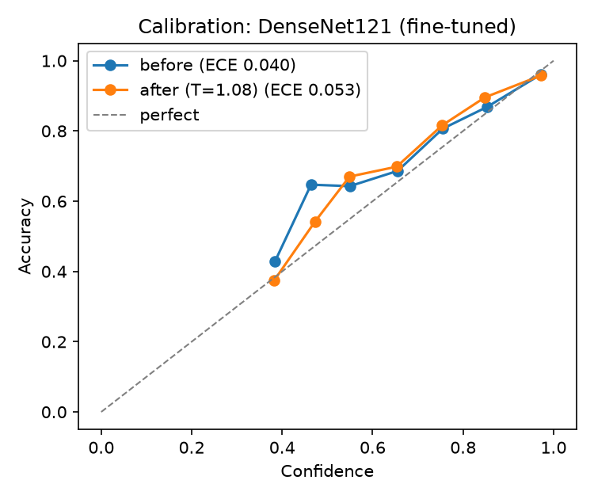

# Model comparison

Test set: 837 X-rays, patient-disjoint from train/val. 95% bootstrap confidence intervals in brackets. p = McNemar test vs the best model.

| Model | Accuracy | Macro-F1 | ROC-AUC (OvR) | ECE ↓ | p vs best | Notes |
|---|---|---|---|---|---|---|
| Logistic Regression (HOG) | 0.771 [0.744–0.798] | 0.762 [0.734–0.790] | 0.900 [0.884–0.915] | 0.062 | 1.2e-05 | classical baseline |
| Random Forest (HOG) | 0.780 [0.751–0.808] | 0.747 [0.717–0.779] | 0.905 [0.890–0.921] | 0.113 | 5.7e-06 | classical baseline |
| CNN (scratch) | 0.800 [0.775–0.826] | 0.787 [0.761–0.813] | 0.904 [0.889–0.920] | 0.041 | 0.0097 | learned features |
| DenseNet121 (frozen) | 0.800 [0.774–0.827] | 0.779 [0.752–0.807] | 0.908 [0.894–0.924] | 0.030 | 0.0088 | transfer, stage 1 |
| **DenseNet121 (fine-tuned)** | 0.829 [0.805–0.853] | 0.811 [0.785–0.838] | 0.924 [0.912–0.938] | 0.040 | — | transfer, stage 2 |

## Per-class F1

| Model | Normal | Bacterial | Viral |
|---|---|---|---|
| Logistic Regression (HOG) | 0.892 | 0.797 | 0.597 |
| Random Forest (HOG) | 0.895 | 0.814 | 0.532 |
| CNN (scratch) | 0.911 | 0.822 | 0.630 |
| DenseNet121 (frozen) | 0.895 | 0.836 | 0.608 |
| DenseNet121 (fine-tuned) | 0.928 | 0.854 | 0.653 |

## Where the difficulty is: binary vs subtype

| Model | Normal vs Pneumonia acc | Normal vs Pneumonia AUC | Bacterial vs Viral acc | Bacterial vs Viral macro-F1 |
|---|---|---|---|---|
| Logistic Regression (HOG) | 0.938 | 0.983 | 0.748 | 0.728 |
| Random Forest (HOG) | 0.934 | 0.983 | 0.763 | 0.698 |
| CNN (scratch) | 0.951 | 0.985 | 0.782 | 0.752 |
| DenseNet121 (frozen) | 0.937 | 0.981 | 0.792 | 0.753 |
| DenseNet121 (fine-tuned) | 0.959 | 0.993 | 0.809 | 0.781 |

## Calibration (DenseNet121 (fine-tuned))

Temperature fitted on validation: **T = 1.08**. Accuracy is unchanged; only confidence changes.

| | ECE ↓ |
|---|---|
| Before | 0.040 |
| After temperature scaling | 0.053 |

T is close to 1, so the fine-tuned model was already well calibrated. Scaling does not improve test ECE here; the small difference is within val/test noise.

## Selective prediction ("refer to radiologist")

Confidence threshold chosen on validation to reach 90% accuracy on answered cases: **0.76**.

On test the model answers **60.9%** of X-rays with **91.8%** accuracy (vs 82.9% if forced to answer everything); the other 39.1% are flagged for human review.

