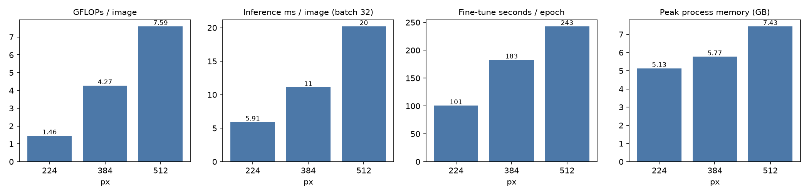
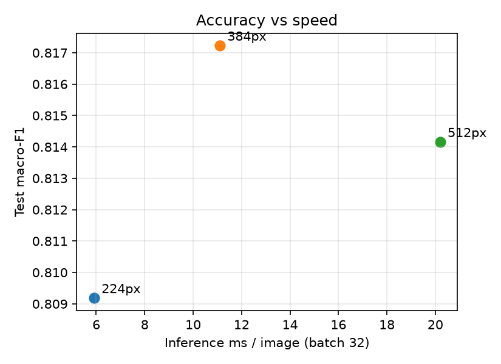

# Resolution study: EfficientNetV2-B0

Same split, seed, augmentation, two-stage recipe and batch size (16) at every resolution; only the input size changes. Test set n = 837.

## Accuracy

| Resolution | Val macro-F1 | Test accuracy | Test macro-F1 | ROC-AUC | ECE | McNemar p vs 224px |
|---|---|---|---|---|---|---|
| 224px | 0.819 | 0.818 [0.793–0.843] | 0.809 [0.783–0.836] | 0.916 | 0.050 | — |
| 384px | 0.805 | 0.834 [0.810–0.859] | 0.817 [0.790–0.844] | 0.924 | 0.049 | 0.13 |
| 512px | 0.809 | 0.826 [0.803–0.851] | 0.814 [0.791–0.841] | 0.928 | 0.036 | 0.53 |

## Per class (test)

| Resolution | Normal P / R / F1 | Bacterial P / R / F1 | Viral P / R / F1 | Normal vs Pneumonia acc | Bacterial vs Viral acc |
|---|---|---|---|---|---|
| 224px | 0.94 / 0.93 / **0.933** | 0.83 / 0.85 / **0.839** | 0.67 / 0.64 / **0.656** | 0.963 | 0.794 |
| 384px | 0.92 / 0.96 / **0.939** | 0.82 / 0.89 / **0.858** | 0.74 / 0.59 / **0.654** | 0.969 | 0.812 |
| 512px | 0.95 / 0.91 / **0.928** | 0.81 / 0.88 / **0.848** | 0.71 / 0.63 / **0.667** | 0.961 | 0.810 |

## Computational cost (measured on the training machine)

| Resolution | Params | GFLOPs / image | Inference ms / image (batch 1) | Inference ms / image (batch 32) | Stage-1 s / epoch | Stage-2 s / epoch | Epochs (S1 + S2) | Total train time | Peak memory |
|---|---|---|---|---|---|---|---|---|---|
| 224px | 6,248,019 | 1.46 | 99.2 | 5.91 | 30 | 101 | 16 + 17 | 37 min | 5.1 GB |
| 384px | 6,248,019 | 4.27 | 96.8 | 11.10 | 75 | 183 | 8 + 11 | 45 min | 5.8 GB |
| 512px | 6,248,019 | 7.59 | 93.6 | 20.19 | 109 | 243 | 8 + 11 | 60 min | 7.4 GB |

